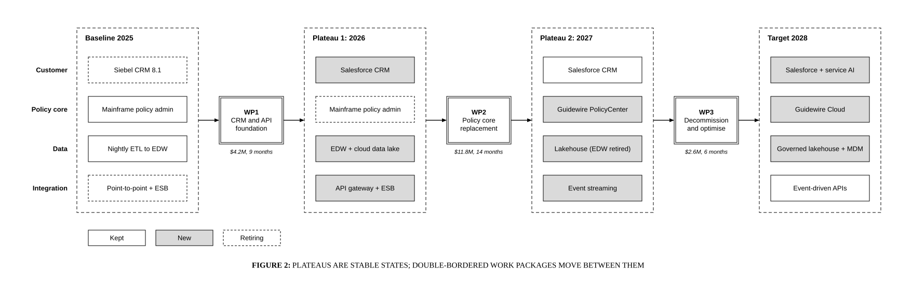

# Core Systems Transition Roadmap: Baseline to Target

## Bill of Materials

| Symbol / ID | Label | Kind | Group | Technical Notes / Metadata |
| :--- | :--- | :--- | :--- | :--- |
| `shape_6` | **Siebel CRM 8.1** | box | Baseline 2025 | plateau: Baseline 2025, domain: Customer, state: retiring |
| `shape_7` | **Mainframe policy admin** | box | Baseline 2025 | plateau: Baseline 2025, domain: Policy core, state: kept |
| `shape_8` | **Nightly ETL to EDW** | box | Baseline 2025 | plateau: Baseline 2025, domain: Data, state: kept |
| `shape_9` | **Point-to-point + ESB** | box | Baseline 2025 | plateau: Baseline 2025, domain: Integration, state: retiring |
| `shape_11` | **Salesforce CRM** | box | Plateau 1: 2026 | plateau: Plateau 1: 2026, domain: Customer, state: new |
| `shape_12` | **Mainframe policy admin** | box | Plateau 1: 2026 | plateau: Plateau 1: 2026, domain: Policy core, state: retiring |
| `shape_13` | **EDW + cloud data lake** | box | Plateau 1: 2026 | plateau: Plateau 1: 2026, domain: Data, state: new |
| `shape_14` | **API gateway + ESB** | box | Plateau 1: 2026 | plateau: Plateau 1: 2026, domain: Integration, state: new |
| `shape_16` | **Salesforce CRM** | box | Plateau 2: 2027 | plateau: Plateau 2: 2027, domain: Customer, state: kept |
| `shape_17` | **Guidewire PolicyCenter** | box | Plateau 2: 2027 | plateau: Plateau 2: 2027, domain: Policy core, state: new |
| `shape_18` | **Lakehouse (EDW retired)** | box | Plateau 2: 2027 | plateau: Plateau 2: 2027, domain: Data, state: new |
| `shape_19` | **Event streaming** | box | Plateau 2: 2027 | plateau: Plateau 2: 2027, domain: Integration, state: new |
| `shape_21` | **Salesforce + service AI** | box | Target 2028 | plateau: Target 2028, domain: Customer, state: new |
| `shape_22` | **Guidewire Cloud** | box | Target 2028 | plateau: Target 2028, domain: Policy core, state: new |
| `shape_23` | **Governed lakehouse + MDM** | box | Target 2028 | plateau: Target 2028, domain: Data, state: new |
| `shape_24` | **Event-driven APIs** | box | Target 2028 | plateau: Target 2028, domain: Integration, state: kept |
| `shape_25` | ****WP1** CRM and API foundation** | box | - | type: Work Package, budget: $4.2M, 9 months |
| `shape_27` | ****WP2** Policy core replacement** | box | - | type: Work Package, budget: $11.8M, 14 months |
| `shape_29` | ****WP3** Decommission and optimise** | box | - | type: Work Package, budget: $2.6M, 6 months |
| `shape_31` | **Kept** | box | - | legend: state |
| `shape_32` | **New** | box | - | legend: state |
| `shape_33` | **Retiring** | box | - | legend: state |

## Connections

| Source | Target | Protocol / Label | Style | Routing |
| :--- | :--- | :--- | :--- | :--- |
| **Baseline 2025** (`group_5`) | ****WP1** CRM and API foundation** (`shape_25`) | - | solid | orthogonal |
| ****WP1** CRM and API foundation** (`shape_25`) | **Plateau 1: 2026** (`group_10`) | - | solid | orthogonal |
| **Plateau 1: 2026** (`group_10`) | ****WP2** Policy core replacement** (`shape_27`) | - | solid | orthogonal |
| ****WP2** Policy core replacement** (`shape_27`) | **Plateau 2: 2027** (`group_15`) | - | solid | orthogonal |
| **Plateau 2: 2027** (`group_15`) | ****WP3** Decommission and optimise** (`shape_29`) | - | solid | orthogonal |
| ****WP3** Decommission and optimise** (`shape_29`) | **Target 2028** (`group_20`) | - | solid | orthogonal |
