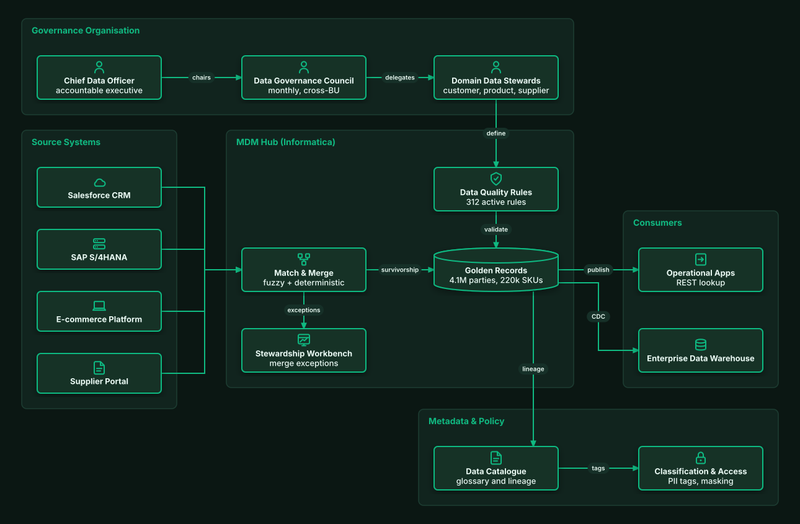

# Enterprise Data Governance and Master Data Management

## Bill of Materials

| Symbol / ID | Label | Kind | Group | Technical Notes / Metadata |
| :--- | :--- | :--- | :--- | :--- |
| `shape_2` | ****Chief Data Officer** accountable executive** | box | Governance Organisation | raci: Accountable |
| `shape_3` | ****Data Governance Council** monthly, cross-BU** | box | Governance Organisation | raci: Decides |
| `shape_4` | ****Domain Data Stewards** customer, product, supplier** | box | Governance Organisation | raci: Responsible |
| `shape_6` | ****Salesforce CRM**** | box | Source Systems | domain: Customer |
| `shape_7` | ****SAP S/4HANA**** | box | Source Systems | domain: Product, Supplier |
| `shape_8` | ****E-commerce Platform**** | box | Source Systems | domain: Customer |
| `shape_9` | ****Supplier Portal**** | box | Source Systems | domain: Supplier |
| `shape_11` | ****Data Quality Rules** 312 active rules** | box | MDM Hub (Informatica) | component: DQ engine |
| `shape_12` | ****Match & Merge** fuzzy + deterministic** | box | MDM Hub (Informatica) | component: Matching |
| `shape_13` | ****Golden Records** 4.1M parties, 220k SKUs** | cylinder | MDM Hub (Informatica) | component: Hub store |
| `shape_14` | ****Stewardship Workbench** merge exceptions** | box | MDM Hub (Informatica) | component: Data stewardship UI |
| `shape_16` | ****Enterprise Data Warehouse**** | box | Consumers | access: CDC |
| `shape_17` | ****Operational Apps** REST lookup** | box | Consumers | access: API |
| `shape_19` | ****Data Catalogue** glossary and lineage** | box | Metadata & Policy | product: Collibra |
| `shape_20` | ****Classification & Access** PII tags, masking** | box | Metadata & Policy | product: Immuta |

## Connections

| Source | Target | Protocol / Label | Style | Routing |
| :--- | :--- | :--- | :--- | :--- |
| ****Chief Data Officer** accountable executive** (`shape_2`) | ****Data Governance Council** monthly, cross-BU** (`shape_3`) | chairs | solid | orthogonal |
| ****Data Governance Council** monthly, cross-BU** (`shape_3`) | ****Domain Data Stewards** customer, product, supplier** (`shape_4`) | delegates | solid | orthogonal |
| ****Domain Data Stewards** customer, product, supplier** (`shape_4`) | ****Data Quality Rules** 312 active rules** (`shape_11`) | define | solid | orthogonal |
| ****Salesforce CRM**** (`shape_6`) | ****Match & Merge** fuzzy + deterministic** (`shape_12`) | - | solid | orthogonal |
| ****SAP S/4HANA**** (`shape_7`) | ****Match & Merge** fuzzy + deterministic** (`shape_12`) | - | solid | orthogonal |
| ****E-commerce Platform**** (`shape_8`) | ****Match & Merge** fuzzy + deterministic** (`shape_12`) | - | solid | orthogonal |
| ****Supplier Portal**** (`shape_9`) | ****Match & Merge** fuzzy + deterministic** (`shape_12`) | - | solid | orthogonal |
| ****Match & Merge** fuzzy + deterministic** (`shape_12`) | ****Golden Records** 4.1M parties, 220k SKUs** (`shape_13`) | survivorship | solid | orthogonal |
| ****Data Quality Rules** 312 active rules** (`shape_11`) | ****Golden Records** 4.1M parties, 220k SKUs** (`shape_13`) | validate | solid | orthogonal |
| ****Match & Merge** fuzzy + deterministic** (`shape_12`) | ****Stewardship Workbench** merge exceptions** (`shape_14`) | exceptions | solid | orthogonal |
| ****Golden Records** 4.1M parties, 220k SKUs** (`shape_13`) | ****Operational Apps** REST lookup** (`shape_17`) | publish | solid | orthogonal |
| ****Golden Records** 4.1M parties, 220k SKUs** (`shape_13`) | ****Enterprise Data Warehouse**** (`shape_16`) | CDC | solid | orthogonal |
| ****Golden Records** 4.1M parties, 220k SKUs** (`shape_13`) | ****Data Catalogue** glossary and lineage** (`shape_19`) | lineage | solid | orthogonal |
| ****Data Catalogue** glossary and lineage** (`shape_19`) | ****Classification & Access** PII tags, masking** (`shape_20`) | tags | solid | orthogonal |
