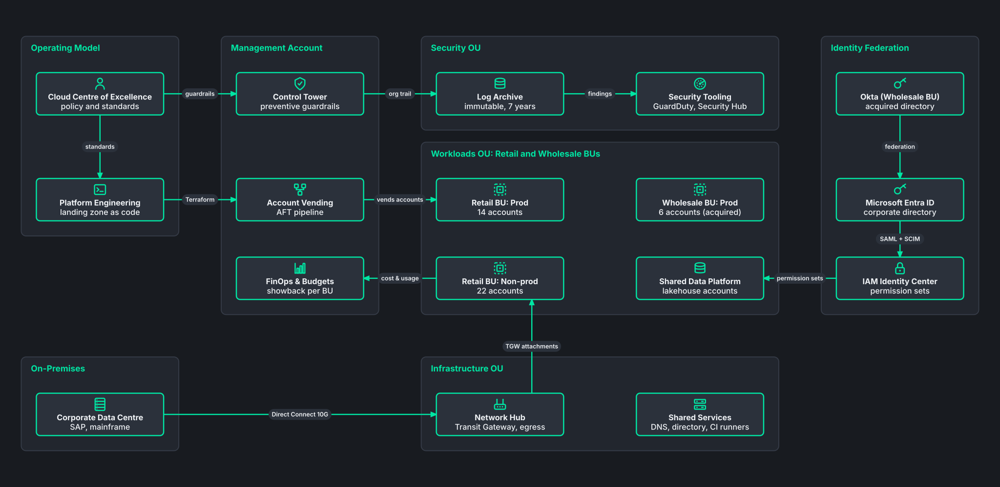

# Multi-Business-Unit Cloud Landing Zone and Operating Model

## Bill of Materials

| Symbol / ID | Label | Kind | Group | Technical Notes / Metadata |
| :--- | :--- | :--- | :--- | :--- |
| `shape_2` | ****Cloud Centre of Excellence** policy and standards** | box | Operating Model | team: CCoE |
| `shape_3` | ****Platform Engineering** landing zone as code** | box | Operating Model | team: Platform |
| `shape_5` | ****Control Tower** preventive guardrails** | box | Management Account | service: AWS Control Tower |
| `shape_6` | ****Account Vending** AFT pipeline** | box | Management Account | service: Account Factory for Terraform |
| `shape_7` | ****FinOps & Budgets** showback per BU** | box | Management Account | service: Cost Explorer + CUR |
| `shape_9` | ****Log Archive** immutable, 7 years** | box | Security OU | account: log-archive |
| `shape_10` | ****Security Tooling** GuardDuty, Security Hub** | box | Security OU | account: audit |
| `shape_12` | ****Retail BU: Prod** 14 accounts** | box | Workloads OU: Retail and Wholesale BUs | bu: Retail, env: prod |
| `shape_13` | ****Wholesale BU: Prod** 6 accounts (acquired)** | box | Workloads OU: Retail and Wholesale BUs | bu: Wholesale, env: prod |
| `shape_14` | ****Retail BU: Non-prod** 22 accounts** | box | Workloads OU: Retail and Wholesale BUs | bu: Retail, env: non-prod |
| `shape_15` | ****Shared Data Platform** lakehouse accounts** | box | Workloads OU: Retail and Wholesale BUs | bu: Group Data, env: prod |
| `shape_17` | ****Network Hub** Transit Gateway, egress** | box | Infrastructure OU | account: network |
| `shape_18` | ****Shared Services** DNS, directory, CI runners** | box | Infrastructure OU | account: shared-services |
| `shape_20` | ****Okta (Wholesale BU)** acquired directory** | box | Identity Federation | idp: Okta |
| `shape_21` | ****Microsoft Entra ID** corporate directory** | box | Identity Federation | idp: Entra ID |
| `shape_22` | ****IAM Identity Center** permission sets** | box | Identity Federation | service: AWS IAM Identity Center |
| `shape_24` | ****Corporate Data Centre** SAP, mainframe** | box | On-Premises | site: Dallas DC1 |

## Connections

| Source | Target | Protocol / Label | Style | Routing |
| :--- | :--- | :--- | :--- | :--- |
| ****Cloud Centre of Excellence** policy and standards** (`shape_2`) | ****Control Tower** preventive guardrails** (`shape_5`) | guardrails | solid | orthogonal |
| ****Cloud Centre of Excellence** policy and standards** (`shape_2`) | ****Platform Engineering** landing zone as code** (`shape_3`) | standards | solid | orthogonal |
| ****Platform Engineering** landing zone as code** (`shape_3`) | ****Account Vending** AFT pipeline** (`shape_6`) | Terraform | solid | orthogonal |
| ****Control Tower** preventive guardrails** (`shape_5`) | ****Log Archive** immutable, 7 years** (`shape_9`) | org trail | solid | orthogonal |
| ****Log Archive** immutable, 7 years** (`shape_9`) | ****Security Tooling** GuardDuty, Security Hub** (`shape_10`) | findings | solid | orthogonal |
| ****Account Vending** AFT pipeline** (`shape_6`) | ****Retail BU: Prod** 14 accounts** (`shape_12`) | vends accounts | solid | orthogonal |
| ****Retail BU: Non-prod** 22 accounts** (`shape_14`) | ****FinOps & Budgets** showback per BU** (`shape_7`) | cost & usage | solid | orthogonal |
| ****Corporate Data Centre** SAP, mainframe** (`shape_24`) | ****Network Hub** Transit Gateway, egress** (`shape_17`) | Direct Connect 10G | solid | orthogonal |
| ****Network Hub** Transit Gateway, egress** (`shape_17`) | ****Retail BU: Non-prod** 22 accounts** (`shape_14`) | TGW attachments | solid | orthogonal |
| ****Okta (Wholesale BU)** acquired directory** (`shape_20`) | ****Microsoft Entra ID** corporate directory** (`shape_21`) | federation | solid | orthogonal |
| ****Microsoft Entra ID** corporate directory** (`shape_21`) | ****IAM Identity Center** permission sets** (`shape_22`) | SAML + SCIM | solid | orthogonal |
| ****IAM Identity Center** permission sets** (`shape_22`) | ****Shared Data Platform** lakehouse accounts** (`shape_15`) | permission sets | solid | orthogonal |
