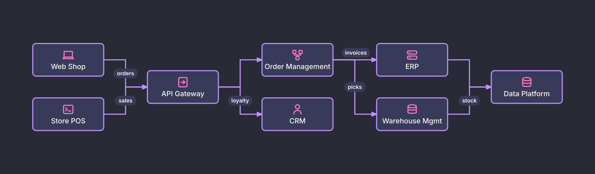

# Auto-Laid-Out Retail Application Landscape

## Bill of Materials

| Symbol / ID | Label | Kind | Group | Technical Notes / Metadata |
| :--- | :--- | :--- | :--- | :--- |
| `shape_1` | **Web Shop** | box | - | - |
| `shape_2` | **Store POS** | box | - | - |
| `shape_3` | **API Gateway** | box | - | - |
| `shape_4` | **Order Management** | box | - | - |
| `shape_5` | **CRM** | box | - | - |
| `shape_6` | **ERP** | box | - | - |
| `shape_7` | **Warehouse Mgmt** | box | - | - |
| `shape_8` | **Data Platform** | box | - | - |

## Connections

| Source | Target | Protocol / Label | Style | Routing |
| :--- | :--- | :--- | :--- | :--- |
| **Web Shop** (`shape_1`) | **API Gateway** (`shape_3`) | orders | solid | orthogonal |
| **Store POS** (`shape_2`) | **API Gateway** (`shape_3`) | sales | solid | orthogonal |
| **API Gateway** (`shape_3`) | **Order Management** (`shape_4`) | - | solid | orthogonal |
| **API Gateway** (`shape_3`) | **CRM** (`shape_5`) | loyalty | solid | orthogonal |
| **Order Management** (`shape_4`) | **ERP** (`shape_6`) | invoices | solid | orthogonal |
| **Order Management** (`shape_4`) | **Warehouse Mgmt** (`shape_7`) | picks | solid | orthogonal |
| **ERP** (`shape_6`) | **Data Platform** (`shape_8`) | - | solid | orthogonal |
| **Warehouse Mgmt** (`shape_7`) | **Data Platform** (`shape_8`) | stock | solid | orthogonal |
