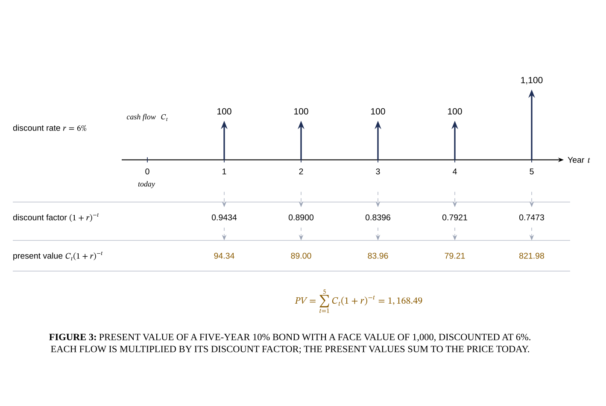

# Present value timeline

## Bill of Materials

| Symbol / ID | Label | Kind | Group | Technical Notes / Metadata |
| :--- | :--- | :--- | :--- | :--- |

## Connections

| Source | Target | Protocol / Label | Style | Routing |
| :--- | :--- | :--- | :--- | :--- |
| **point_1** (`point_1`) | **point_2** (`point_2`) | - | solid | direct |
| **point_12** (`point_12`) | **point_13** (`point_13`) | - | solid | direct |
| **point_15** (`point_15`) | **point_16** (`point_16`) | - | solid | direct |
| **point_18** (`point_18`) | **point_19** (`point_19`) | - | solid | direct |
| **point_21** (`point_21`) | **point_22** (`point_22`) | - | solid | direct |
| **point_24** (`point_24`) | **point_25** (`point_25`) | - | solid | direct |
| **point_35** (`point_35`) | **point_36** (`point_36`) | - | dashed | direct |
| **point_37** (`point_37`) | **point_38** (`point_38`) | - | dashed | direct |
| **point_41** (`point_41`) | **point_42** (`point_42`) | - | dashed | direct |
| **point_43** (`point_43`) | **point_44** (`point_44`) | - | dashed | direct |
| **point_47** (`point_47`) | **point_48** (`point_48`) | - | dashed | direct |
| **point_49** (`point_49`) | **point_50** (`point_50`) | - | dashed | direct |
| **point_53** (`point_53`) | **point_54** (`point_54`) | - | dashed | direct |
| **point_55** (`point_55`) | **point_56** (`point_56`) | - | dashed | direct |
| **point_59** (`point_59`) | **point_60** (`point_60`) | - | dashed | direct |
| **point_61** (`point_61`) | **point_62** (`point_62`) | - | dashed | direct |
