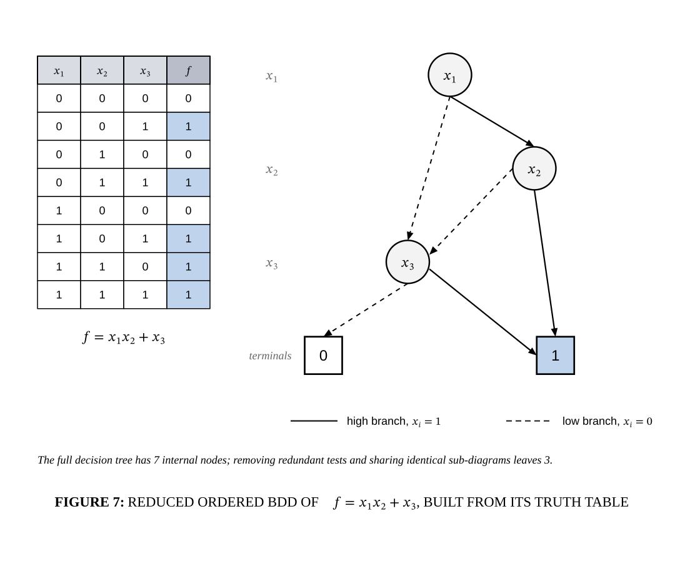

# Binary decision diagram

## Bill of Materials

| Symbol / ID | Label | Kind | Group | Technical Notes / Metadata |
| :--- | :--- | :--- | :--- | :--- |
| `shape_38` | **$x_3$** | box | - | - |
| `shape_39` | **$x_2$** | box | - | - |
| `shape_40` | **$x_1$** | box | - | - |
| `shape_41` | **0** | box | - | - |
| `shape_42` | **1** | box | - | - |

## Connections

| Source | Target | Protocol / Label | Style | Routing |
| :--- | :--- | :--- | :--- | :--- |
| **$x_3$** (`shape_38`) | **0** (`shape_41`) | - | dashed | direct |
| **$x_3$** (`shape_38`) | **1** (`shape_42`) | - | solid | direct |
| **$x_2$** (`shape_39`) | **$x_3$** (`shape_38`) | - | dashed | direct |
| **$x_2$** (`shape_39`) | **1** (`shape_42`) | - | solid | direct |
| **$x_1$** (`shape_40`) | **$x_3$** (`shape_38`) | - | dashed | direct |
| **$x_1$** (`shape_40`) | **$x_2$** (`shape_39`) | - | solid | direct |
