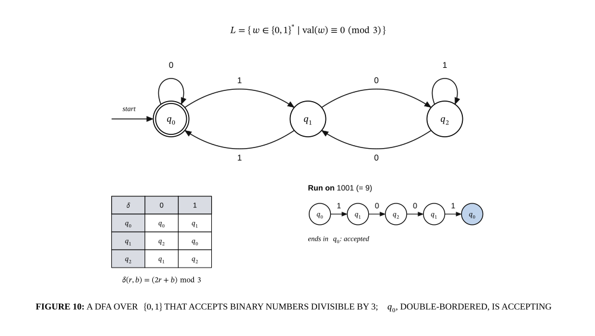

# DFA for multiples of three

## Bill of Materials

| Symbol / ID | Label | Kind | Group | Technical Notes / Metadata |
| :--- | :--- | :--- | :--- | :--- |
| `shape_2` | **$q_0$** | box | - | - |
| `shape_3` | **$q_1$** | box | - | - |
| `shape_4` | **$q_2$** | box | - | - |
