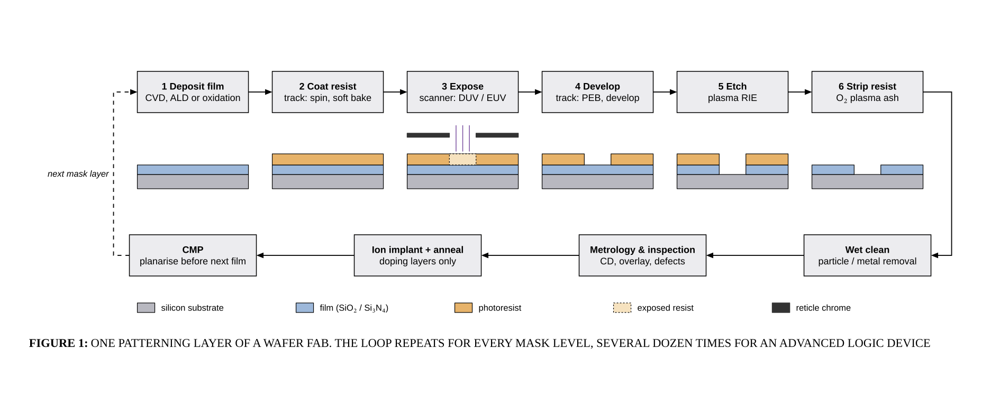

# Front-End Wafer Fab Re-entrant Process Loop

## Bill of Materials

| Symbol / ID | Label | Kind | Group | Technical Notes / Metadata |
| :--- | :--- | :--- | :--- | :--- |
| `shape_1` | ****1 Deposit film** CVD, ALD or oxidation** | box | - | - |
| `shape_2` | ****2 Coat resist** track: spin, soft bake** | box | - | - |
| `shape_3` | ****3 Expose** scanner: DUV / EUV** | box | - | - |
| `shape_4` | ****4 Develop** track: PEB, develop** | box | - | - |
| `shape_5` | ****5 Etch** plasma RIE** | box | - | - |
| `shape_6` | ****6 Strip resist** O$_2$ plasma ash** | box | - | - |
| `shape_33` | ****Wet clean** particle / metal removal** | box | - | - |
| `shape_34` | ****Metrology & inspection** CD, overlay, defects** | box | - | - |
| `shape_35` | ****Ion implant + anneal** doping layers only** | box | - | - |
| `shape_36` | ****CMP** planarise before next film** | box | - | - |

## Connections

| Source | Target | Protocol / Label | Style | Routing |
| :--- | :--- | :--- | :--- | :--- |
| ****1 Deposit film** CVD, ALD or oxidation** (`shape_1`) | ****2 Coat resist** track: spin, soft bake** (`shape_2`) | - | solid | orthogonal |
| ****2 Coat resist** track: spin, soft bake** (`shape_2`) | ****3 Expose** scanner: DUV / EUV** (`shape_3`) | - | solid | orthogonal |
| ****3 Expose** scanner: DUV / EUV** (`shape_3`) | ****4 Develop** track: PEB, develop** (`shape_4`) | - | solid | orthogonal |
| ****4 Develop** track: PEB, develop** (`shape_4`) | ****5 Etch** plasma RIE** (`shape_5`) | - | solid | orthogonal |
| ****5 Etch** plasma RIE** (`shape_5`) | ****6 Strip resist** O$_2$ plasma ash** (`shape_6`) | - | solid | orthogonal |
| ****6 Strip resist** O$_2$ plasma ash** (`shape_6`) | ****Wet clean** particle / metal removal** (`shape_33`) | - | solid | orthogonal |
| ****Wet clean** particle / metal removal** (`shape_33`) | ****Metrology & inspection** CD, overlay, defects** (`shape_34`) | - | solid | orthogonal |
| ****Metrology & inspection** CD, overlay, defects** (`shape_34`) | ****Ion implant + anneal** doping layers only** (`shape_35`) | - | solid | orthogonal |
| ****Ion implant + anneal** doping layers only** (`shape_35`) | ****CMP** planarise before next film** (`shape_36`) | - | solid | orthogonal |
| ****CMP** planarise before next film** (`shape_36`) | ****1 Deposit film** CVD, ALD or oxidation** (`shape_1`) | - | dashed | orthogonal |
