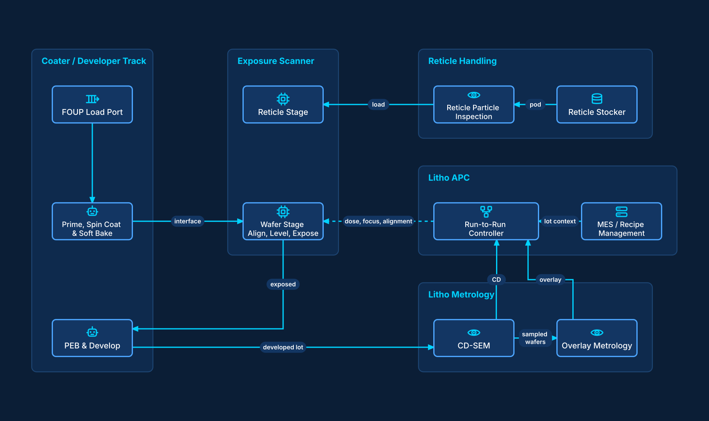

# Lithography Cell with Overlay & CD Feedback

## Bill of Materials

| Symbol / ID | Label | Kind | Group | Technical Notes / Metadata |
| :--- | :--- | :--- | :--- | :--- |
| `shape_2` | **FOUP Load Port** | box | Coater / Developer Track | carrier: 25-wafer FOUP |
| `shape_3` | **Prime, Spin Coat & Soft Bake** | box | Coater / Developer Track | modules: HMDS / coat / bake |
| `shape_4` | **PEB & Develop** | box | Coater / Developer Track | modules: PEB / develop / hard bake |
| `shape_6` | **Reticle Stage** | box | Exposure Scanner | motion: synchronous scan |
| `shape_7` | **Wafer Stage Align, Level, Expose** | box | Exposure Scanner | source: ArF immersion or EUV |
| `shape_9` | **Reticle Particle Inspection** | box | Reticle Handling | check: before load |
| `shape_10` | **Reticle Stocker** | box | Reticle Handling | carrier: reticle pod |
| `shape_12` | **Run-to-Run Controller** | box | Litho APC | model: EWMA per context |
| `shape_13` | **MES / Recipe Management** | box | Litho APC | role: lot dispatch |
| `shape_15` | **CD-SEM** | box | Litho Metrology | measures: critical dimension |
| `shape_16` | **Overlay Metrology** | box | Litho Metrology | method: image or diffraction based |

## Connections

| Source | Target | Protocol / Label | Style | Routing |
| :--- | :--- | :--- | :--- | :--- |
| **FOUP Load Port** (`shape_2`) | **Prime, Spin Coat & Soft Bake** (`shape_3`) | - | solid | orthogonal |
| **Prime, Spin Coat & Soft Bake** (`shape_3`) | **Wafer Stage Align, Level, Expose** (`shape_7`) | interface | solid | orthogonal |
| **Wafer Stage Align, Level, Expose** (`shape_7`) | **PEB & Develop** (`shape_4`) | exposed | solid | orthogonal |
| **Reticle Stocker** (`shape_10`) | **Reticle Particle Inspection** (`shape_9`) | pod | solid | orthogonal |
| **Reticle Particle Inspection** (`shape_9`) | **Reticle Stage** (`shape_6`) | load | solid | orthogonal |
| **PEB & Develop** (`shape_4`) | **CD-SEM** (`shape_15`) | developed lot | solid | orthogonal |
| **CD-SEM** (`shape_15`) | **Overlay Metrology** (`shape_16`) | sampled wafers | solid | orthogonal |
| **CD-SEM** (`shape_15`) | **Run-to-Run Controller** (`shape_12`) | CD | solid | orthogonal |
| **Overlay Metrology** (`shape_16`) | **Run-to-Run Controller** (`shape_12`) | overlay | solid | orthogonal |
| **Run-to-Run Controller** (`shape_12`) | **Wafer Stage Align, Level, Expose** (`shape_7`) | dose, focus, alignment | dashed | orthogonal |
| **MES / Recipe Management** (`shape_13`) | **Run-to-Run Controller** (`shape_12`) | lot context | solid | orthogonal |
