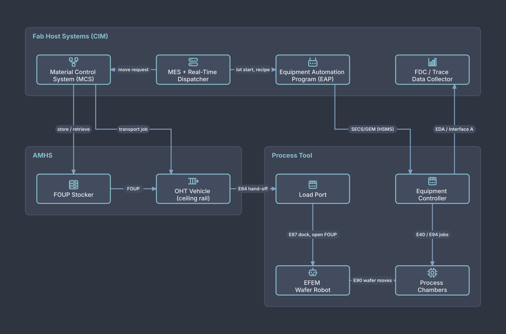

# 300 mm Fab Automation: MES to AMHS to Tool

## Bill of Materials

| Symbol / ID | Label | Kind | Group | Technical Notes / Metadata |
| :--- | :--- | :--- | :--- | :--- |
| `shape_2` | **Material Control System (MCS)** | box | Fab Host Systems (CIM) | role: transport orchestration |
| `shape_3` | **MES + Real-Time Dispatcher** | box | Fab Host Systems (CIM) | role: lot tracking, what-next |
| `shape_4` | **Equipment Automation Program (EAP)** | box | Fab Host Systems (CIM) | role: tool host |
| `shape_5` | **FDC / Trace Data Collector** | box | Fab Host Systems (CIM) | role: fault detection |
| `shape_7` | **FOUP Stocker** | box | AMHS | capacity: hundreds of FOUPs |
| `shape_8` | **OHT Vehicle (ceiling rail)** | box | AMHS | payload: 1 FOUP, 25 wafers |
| `shape_10` | **Load Port** | box | Process Tool | standard: SEMI E15.1 / E87 |
| `shape_11` | **Equipment Controller** | box | Process Tool | interfaces: HSMS, EDA |
| `shape_12` | **EFEM Wafer Robot** | box | Process Tool | environment: mini-environment |
| `shape_13` | **Process Chambers** | box | Process Tool | example: etch or CVD |

## Connections

| Source | Target | Protocol / Label | Style | Routing |
| :--- | :--- | :--- | :--- | :--- |
| **MES + Real-Time Dispatcher** (`shape_3`) | **Material Control System (MCS)** (`shape_2`) | move request | solid | orthogonal |
| **MES + Real-Time Dispatcher** (`shape_3`) | **Equipment Automation Program (EAP)** (`shape_4`) | lot start, recipe | solid | orthogonal |
| **Material Control System (MCS)** (`shape_2`) | **FOUP Stocker** (`shape_7`) | store / retrieve | solid | orthogonal |
| **Material Control System (MCS)** (`shape_2`) | **OHT Vehicle (ceiling rail)** (`shape_8`) | transport job | solid | orthogonal |
| **FOUP Stocker** (`shape_7`) | **OHT Vehicle (ceiling rail)** (`shape_8`) | FOUP | solid | orthogonal |
| **OHT Vehicle (ceiling rail)** (`shape_8`) | **Load Port** (`shape_10`) | E84 hand-off | solid | orthogonal |
| **Load Port** (`shape_10`) | **EFEM Wafer Robot** (`shape_12`) | E87 dock, open FOUP | solid | orthogonal |
| **EFEM Wafer Robot** (`shape_12`) | **Process Chambers** (`shape_13`) | E90 wafer moves | solid | orthogonal |
| **Equipment Automation Program (EAP)** (`shape_4`) | **Equipment Controller** (`shape_11`) | SECS/GEM (HSMS) | solid | orthogonal |
| **Equipment Controller** (`shape_11`) | **Process Chambers** (`shape_13`) | E40 / E94 jobs | solid | orthogonal |
| **Equipment Controller** (`shape_11`) | **FDC / Trace Data Collector** (`shape_5`) | EDA / Interface A | solid | orthogonal |
