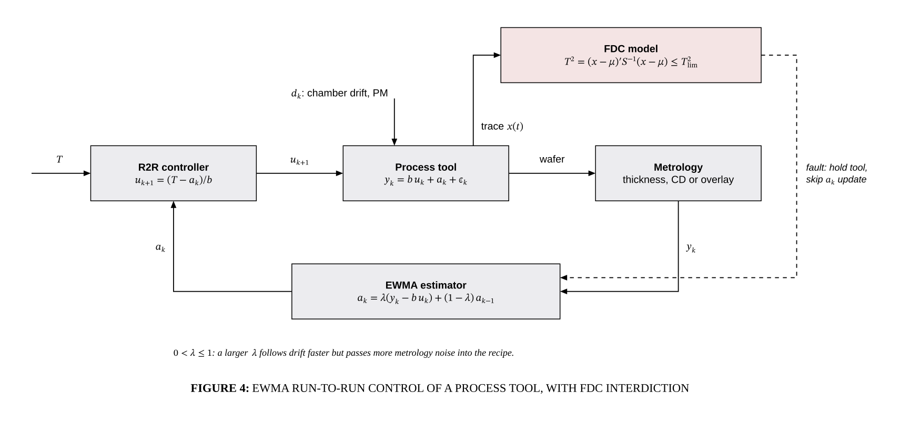

# Run-to-Run Control with Fault Detection

## Bill of Materials

| Symbol / ID | Label | Kind | Group | Technical Notes / Metadata |
| :--- | :--- | :--- | :--- | :--- |
| `shape_1` | ****R2R controller** $u_{k+1} = (T - a_k) / b$** | box | - | - |
| `shape_2` | ****Process tool** $y_k = b\,u_k + a_k + \varepsilon_k$** | box | - | - |
| `shape_3` | ****Metrology** thickness, CD or overlay** | box | - | - |
| `shape_4` | ****EWMA estimator** $a_k = \lambda (y_k - b\,u_k) + (1 - \lambda)\, a_{k-1}$** | box | - | - |
| `shape_5` | ****FDC model** $T^2 = (x - \mu)' S^{-1} (x - \mu) \leq T^2_{\mathrm{lim}}$** | box | - | - |

## Connections

| Source | Target | Protocol / Label | Style | Routing |
| :--- | :--- | :--- | :--- | :--- |
| **point_6** (`point_6`) | ****R2R controller** $u_{k+1} = (T - a_k) / b$** (`shape_1`) | - | solid | direct |
| ****R2R controller** $u_{k+1} = (T - a_k) / b$** (`shape_1`) | ****Process tool** $y_k = b\,u_k + a_k + \varepsilon_k$** (`shape_2`) | - | solid | orthogonal |
| ****Process tool** $y_k = b\,u_k + a_k + \varepsilon_k$** (`shape_2`) | ****Metrology** thickness, CD or overlay** (`shape_3`) | - | solid | orthogonal |
| ****Metrology** thickness, CD or overlay** (`shape_3`) | ****EWMA estimator** $a_k = \lambda (y_k - b\,u_k) + (1 - \lambda)\, a_{k-1}$** (`shape_4`) | - | solid | orthogonal |
| ****EWMA estimator** $a_k = \lambda (y_k - b\,u_k) + (1 - \lambda)\, a_{k-1}$** (`shape_4`) | ****R2R controller** $u_{k+1} = (T - a_k) / b$** (`shape_1`) | - | solid | orthogonal |
| **point_12** (`point_12`) | ****Process tool** $y_k = b\,u_k + a_k + \varepsilon_k$** (`shape_2`) | - | solid | direct |
| ****Process tool** $y_k = b\,u_k + a_k + \varepsilon_k$** (`shape_2`) | ****FDC model** $T^2 = (x - \mu)' S^{-1} (x - \mu) \leq T^2_{\mathrm{lim}}$** (`shape_5`) | - | solid | orthogonal |
| ****FDC model** $T^2 = (x - \mu)' S^{-1} (x - \mu) \leq T^2_{\mathrm{lim}}$** (`shape_5`) | ****EWMA estimator** $a_k = \lambda (y_k - b\,u_k) + (1 - \lambda)\, a_{k-1}$** (`shape_4`) | - | dashed | orthogonal |
