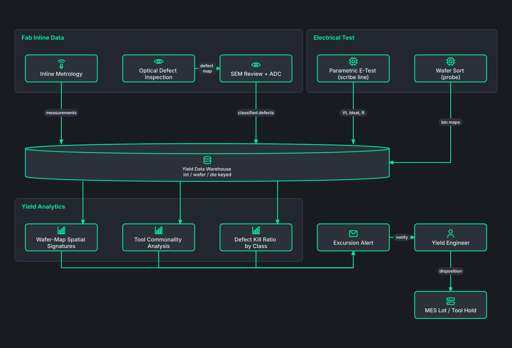

# Semiconductor Yield Management Data Flow

## Bill of Materials

| Symbol / ID | Label | Kind | Group | Technical Notes / Metadata |
| :--- | :--- | :--- | :--- | :--- |
| `shape_2` | **Inline Metrology** | box | Fab Inline Data | measures: film thickness, CD |
| `shape_3` | **Optical Defect Inspection** | box | Fab Inline Data | mode: bright / dark field |
| `shape_4` | **SEM Review + ADC** | box | Fab Inline Data | output: defect class codes |
| `shape_6` | **Parametric E-Test (scribe line)** | box | Electrical Test | structures: PCM test keys |
| `shape_7` | **Wafer Sort (probe)** | box | Electrical Test | output: die bin map |
| `shape_8` | **Yield Data Warehouse lot / wafer / die keyed** | cylinder | - | store: columnar |
| `shape_10` | **Wafer-Map Spatial Signatures** | box | Yield Analytics | method: zone / cluster |
| `shape_11` | **Tool Commonality Analysis** | box | Yield Analytics | method: lot history join |
| `shape_12` | **Defect Kill Ratio by Class** | box | Yield Analytics | method: defect-to-bin overlay |
| `shape_13` | **Excursion Alert** | box | - | trigger: yield below limit |
| `shape_14` | **Yield Engineer** | box | - | role: disposition |
| `shape_15` | **MES Lot / Tool Hold** | box | - | action: hold, scrap, rework |

## Connections

| Source | Target | Protocol / Label | Style | Routing |
| :--- | :--- | :--- | :--- | :--- |
| **Optical Defect Inspection** (`shape_3`) | **SEM Review + ADC** (`shape_4`) | defect map | solid | orthogonal |
| **Inline Metrology** (`shape_2`) | **Yield Data Warehouse lot / wafer / die keyed** (`shape_8`) | measurements | solid | orthogonal |
| **SEM Review + ADC** (`shape_4`) | **Yield Data Warehouse lot / wafer / die keyed** (`shape_8`) | classified defects | solid | orthogonal |
| **Parametric E-Test (scribe line)** (`shape_6`) | **Yield Data Warehouse lot / wafer / die keyed** (`shape_8`) | Vt, Idsat, R | solid | orthogonal |
| **Wafer Sort (probe)** (`shape_7`) | **Yield Data Warehouse lot / wafer / die keyed** (`shape_8`) | bin maps | solid | orthogonal |
| **Yield Data Warehouse lot / wafer / die keyed** (`shape_8`) | **Wafer-Map Spatial Signatures** (`shape_10`) | - | solid | orthogonal |
| **Yield Data Warehouse lot / wafer / die keyed** (`shape_8`) | **Tool Commonality Analysis** (`shape_11`) | - | solid | orthogonal |
| **Yield Data Warehouse lot / wafer / die keyed** (`shape_8`) | **Defect Kill Ratio by Class** (`shape_12`) | - | solid | orthogonal |
| **Wafer-Map Spatial Signatures** (`shape_10`) | **Excursion Alert** (`shape_13`) | - | solid | orthogonal |
| **Tool Commonality Analysis** (`shape_11`) | **Excursion Alert** (`shape_13`) | - | solid | orthogonal |
| **Defect Kill Ratio by Class** (`shape_12`) | **Excursion Alert** (`shape_13`) | - | solid | orthogonal |
| **Excursion Alert** (`shape_13`) | **Yield Engineer** (`shape_14`) | notify | solid | orthogonal |
| **Yield Engineer** (`shape_14`) | **MES Lot / Tool Hold** (`shape_15`) | disposition | solid | orthogonal |
