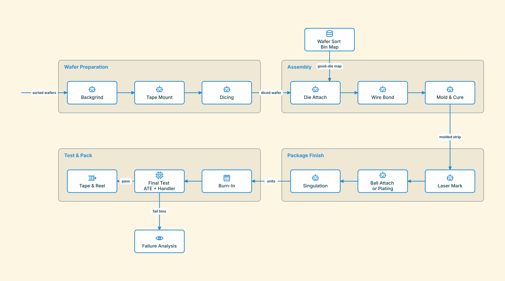

# Semiconductor Back-End Assembly & Test Line

## Bill of Materials

| Symbol / ID | Label | Kind | Group | Technical Notes / Metadata |
| :--- | :--- | :--- | :--- | :--- |
| `shape_2` | **Backgrind** | box | Wafer Preparation | target: thin to package height |
| `shape_3` | **Tape Mount** | box | Wafer Preparation | carrier: film frame |
| `shape_4` | **Dicing** | box | Wafer Preparation | method: blade, laser or stealth |
| `shape_6` | **Die Attach** | box | Assembly | material: epoxy or DAF |
| `shape_7` | **Wire Bond** | box | Assembly | wire: Au or Cu |
| `shape_8` | **Mold & Cure** | box | Assembly | process: transfer molding |
| `shape_10` | **Laser Mark** | box | Package Finish | content: part, lot, date code |
| `shape_11` | **Ball Attach or Plating** | box | Package Finish | finish: solder balls or lead plating |
| `shape_12` | **Singulation** | box | Package Finish | method: saw or punch |
| `shape_14` | **Burn-In** | box | Test & Pack | purpose: screen infant mortality |
| `shape_15` | **Final Test ATE + Handler** | box | Test & Pack | temps: hot / cold |
| `shape_16` | **Tape & Reel** | box | Test & Pack | output: to customer |
| `shape_17` | **Wafer Sort Bin Map** | box | - | source: probe |
| `shape_18` | **Failure Analysis** | box | - | tools: X-ray, decap, SEM |

## Connections

| Source | Target | Protocol / Label | Style | Routing |
| :--- | :--- | :--- | :--- | :--- |
| **point_19** (`point_19`) | **Backgrind** (`shape_2`) | sorted wafers | solid | direct |
| **Backgrind** (`shape_2`) | **Tape Mount** (`shape_3`) | - | solid | orthogonal |
| **Tape Mount** (`shape_3`) | **Dicing** (`shape_4`) | - | solid | orthogonal |
| **Dicing** (`shape_4`) | **Die Attach** (`shape_6`) | diced wafer | solid | orthogonal |
| **Wafer Sort Bin Map** (`shape_17`) | **Die Attach** (`shape_6`) | good-die map | solid | orthogonal |
| **Die Attach** (`shape_6`) | **Wire Bond** (`shape_7`) | - | solid | orthogonal |
| **Wire Bond** (`shape_7`) | **Mold & Cure** (`shape_8`) | - | solid | orthogonal |
| **Mold & Cure** (`shape_8`) | **Laser Mark** (`shape_10`) | molded strip | solid | orthogonal |
| **Laser Mark** (`shape_10`) | **Ball Attach or Plating** (`shape_11`) | - | solid | orthogonal |
| **Ball Attach or Plating** (`shape_11`) | **Singulation** (`shape_12`) | - | solid | orthogonal |
| **Singulation** (`shape_12`) | **Burn-In** (`shape_14`) | units | solid | orthogonal |
| **Burn-In** (`shape_14`) | **Final Test ATE + Handler** (`shape_15`) | - | solid | orthogonal |
| **Final Test ATE + Handler** (`shape_15`) | **Tape & Reel** (`shape_16`) | pass | solid | orthogonal |
| **Final Test ATE + Handler** (`shape_15`) | **Failure Analysis** (`shape_18`) | fail bins | solid | orthogonal |
