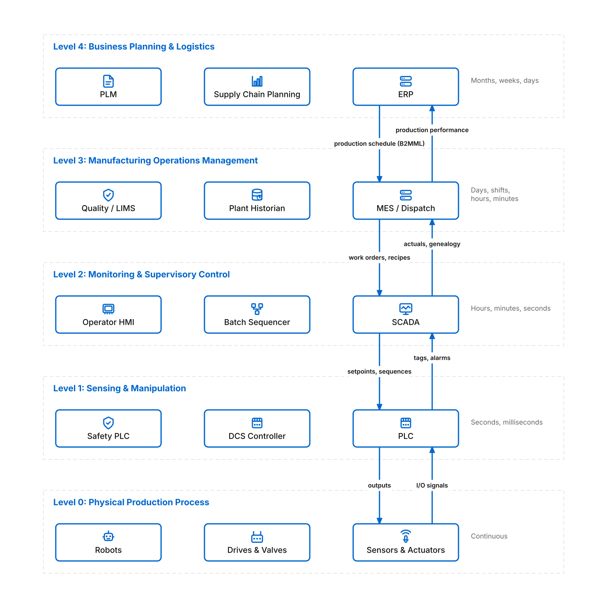

# ISA-95 Functional Hierarchy, Levels 0 to 4

## Bill of Materials

| Symbol / ID | Label | Kind | Group | Technical Notes / Metadata |
| :--- | :--- | :--- | :--- | :--- |
| `shape_2` | **PLM** | box | Level 4: Business Planning & Logistics | - |
| `shape_3` | **Supply Chain Planning** | box | Level 4: Business Planning & Logistics | - |
| `shape_4` | **ERP** | box | Level 4: Business Planning & Logistics | - |
| `shape_6` | **Quality / LIMS** | box | Level 3: Manufacturing Operations Management | - |
| `shape_7` | **Plant Historian** | box | Level 3: Manufacturing Operations Management | - |
| `shape_8` | **MES / Dispatch** | box | Level 3: Manufacturing Operations Management | - |
| `shape_10` | **Operator HMI** | box | Level 2: Monitoring & Supervisory Control | - |
| `shape_11` | **Batch Sequencer** | box | Level 2: Monitoring & Supervisory Control | - |
| `shape_12` | **SCADA** | box | Level 2: Monitoring & Supervisory Control | - |
| `shape_14` | **Safety PLC** | box | Level 1: Sensing & Manipulation | - |
| `shape_15` | **DCS Controller** | box | Level 1: Sensing & Manipulation | - |
| `shape_16` | **PLC** | box | Level 1: Sensing & Manipulation | - |
| `shape_18` | **Robots** | box | Level 0: Physical Production Process | - |
| `shape_19` | **Drives & Valves** | box | Level 0: Physical Production Process | - |
| `shape_20` | **Sensors & Actuators** | box | Level 0: Physical Production Process | - |

## Connections

| Source | Target | Protocol / Label | Style | Routing |
| :--- | :--- | :--- | :--- | :--- |
| **ERP** (`shape_4`) | **MES / Dispatch** (`shape_8`) | production schedule (B2MML) | solid | orthogonal |
| **MES / Dispatch** (`shape_8`) | **ERP** (`shape_4`) | production performance | solid | orthogonal |
| **MES / Dispatch** (`shape_8`) | **SCADA** (`shape_12`) | work orders, recipes | solid | orthogonal |
| **SCADA** (`shape_12`) | **MES / Dispatch** (`shape_8`) | actuals, genealogy | solid | orthogonal |
| **SCADA** (`shape_12`) | **PLC** (`shape_16`) | setpoints, sequences | solid | orthogonal |
| **PLC** (`shape_16`) | **SCADA** (`shape_12`) | tags, alarms | solid | orthogonal |
| **PLC** (`shape_16`) | **Sensors & Actuators** (`shape_20`) | outputs | solid | orthogonal |
| **Sensors & Actuators** (`shape_20`) | **PLC** (`shape_16`) | I/O signals | solid | orthogonal |
