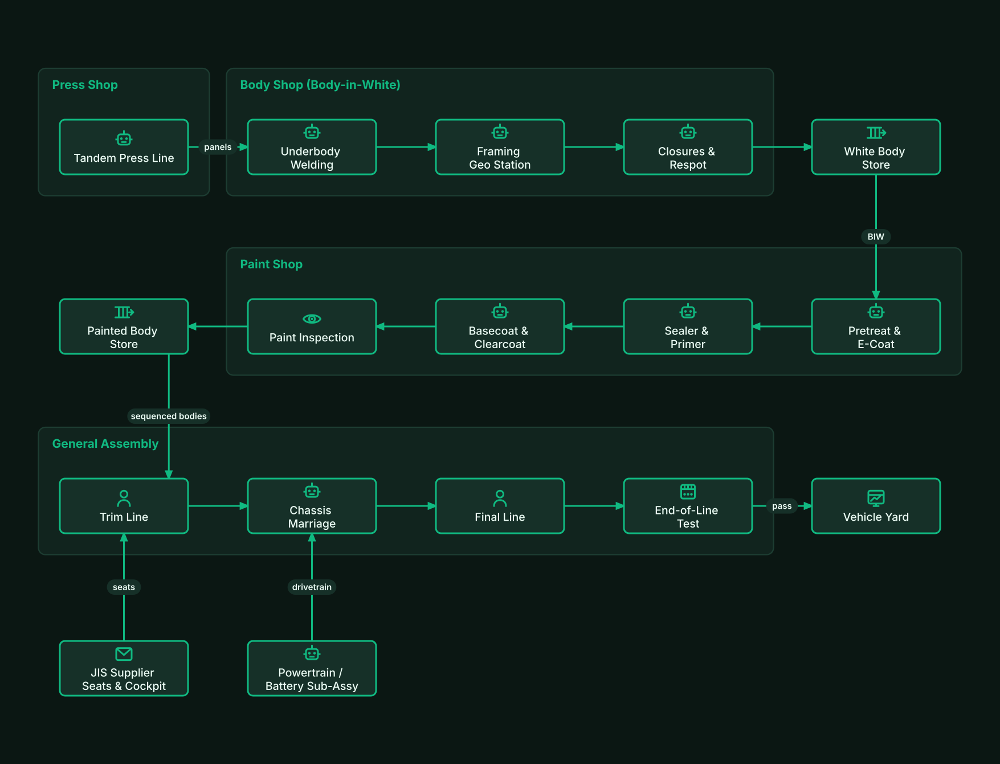

# Automotive Plant Flow: Press, Body, Paint, Assembly

## Bill of Materials

| Symbol / ID | Label | Kind | Group | Technical Notes / Metadata |
| :--- | :--- | :--- | :--- | :--- |
| `shape_2` | **Tandem Press Line** | box | Press Shop | output: stamped panels |
| `shape_4` | **Underbody Welding** | box | Body Shop (Body-in-White) | joining: resistance spot weld |
| `shape_5` | **Framing Geo Station** | box | Body Shop (Body-in-White) | fixes: body geometry |
| `shape_6` | **Closures & Respot** | box | Body Shop (Body-in-White) | parts: doors, hood, liftgate |
| `shape_7` | **White Body Store** | box | - | role: buffer |
| `shape_9` | **Pretreat & E-Coat** | box | Paint Shop | layer: corrosion protection |
| `shape_10` | **Sealer & Primer** | box | Paint Shop | method: robotic seam seal |
| `shape_11` | **Basecoat & Clearcoat** | box | Paint Shop | booths: robotic bells |
| `shape_12` | **Paint Inspection** | box | Paint Shop | check: surface defects |
| `shape_13` | **Painted Body Store** | box | - | role: resequence to build order |
| `shape_15` | **Trim Line** | box | General Assembly | work: harness, glass, seats |
| `shape_16` | **Chassis Marriage** | box | General Assembly | joins: body to drivetrain |
| `shape_17` | **Final Line** | box | General Assembly | work: fluids, wheels, doors back on |
| `shape_18` | **End-of-Line Test** | box | General Assembly | checks: alignment, rolls, water |
| `shape_19` | **Vehicle Yard** | box | - | next: ship to dealer |
| `shape_20` | **JIS Supplier Seats & Cockpit** | box | - | delivery: just in sequence |
| `shape_21` | **Powertrain / Battery Sub-Assy** | box | - | variant: ICE or EV |

## Connections

| Source | Target | Protocol / Label | Style | Routing |
| :--- | :--- | :--- | :--- | :--- |
| **Tandem Press Line** (`shape_2`) | **Underbody Welding** (`shape_4`) | panels | solid | orthogonal |
| **Underbody Welding** (`shape_4`) | **Framing Geo Station** (`shape_5`) | - | solid | orthogonal |
| **Framing Geo Station** (`shape_5`) | **Closures & Respot** (`shape_6`) | - | solid | orthogonal |
| **Closures & Respot** (`shape_6`) | **White Body Store** (`shape_7`) | - | solid | orthogonal |
| **White Body Store** (`shape_7`) | **Pretreat & E-Coat** (`shape_9`) | BIW | solid | orthogonal |
| **Pretreat & E-Coat** (`shape_9`) | **Sealer & Primer** (`shape_10`) | - | solid | orthogonal |
| **Sealer & Primer** (`shape_10`) | **Basecoat & Clearcoat** (`shape_11`) | - | solid | orthogonal |
| **Basecoat & Clearcoat** (`shape_11`) | **Paint Inspection** (`shape_12`) | - | solid | orthogonal |
| **Paint Inspection** (`shape_12`) | **Painted Body Store** (`shape_13`) | - | solid | orthogonal |
| **Painted Body Store** (`shape_13`) | **Trim Line** (`shape_15`) | sequenced bodies | solid | orthogonal |
| **Trim Line** (`shape_15`) | **Chassis Marriage** (`shape_16`) | - | solid | orthogonal |
| **Chassis Marriage** (`shape_16`) | **Final Line** (`shape_17`) | - | solid | orthogonal |
| **Final Line** (`shape_17`) | **End-of-Line Test** (`shape_18`) | - | solid | orthogonal |
| **End-of-Line Test** (`shape_18`) | **Vehicle Yard** (`shape_19`) | pass | solid | orthogonal |
| **JIS Supplier Seats & Cockpit** (`shape_20`) | **Trim Line** (`shape_15`) | seats | solid | orthogonal |
| **Powertrain / Battery Sub-Assy** (`shape_21`) | **Chassis Marriage** (`shape_16`) | drivetrain | solid | orthogonal |
