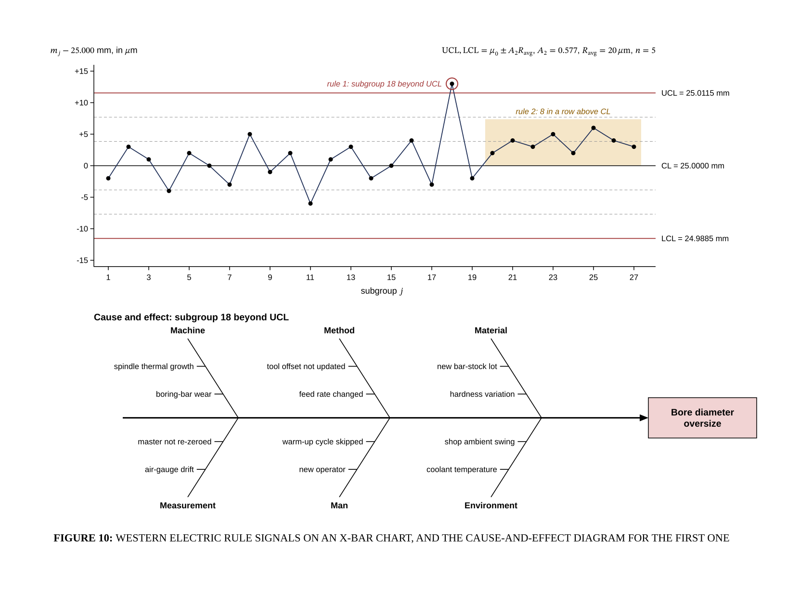

# SPC X-bar Chart and Ishikawa Root-Cause Diagram

## Bill of Materials

| Symbol / ID | Label | Kind | Group | Technical Notes / Metadata |
| :--- | :--- | :--- | :--- | :--- |
| `shape_69` | ****Bore diameter** **oversize**** | box | - | - |

## Connections

| Source | Target | Protocol / Label | Style | Routing |
| :--- | :--- | :--- | :--- | :--- |
| **point_70** (`point_70`) | ****Bore diameter** **oversize**** (`shape_69`) | - | solid | direct |
