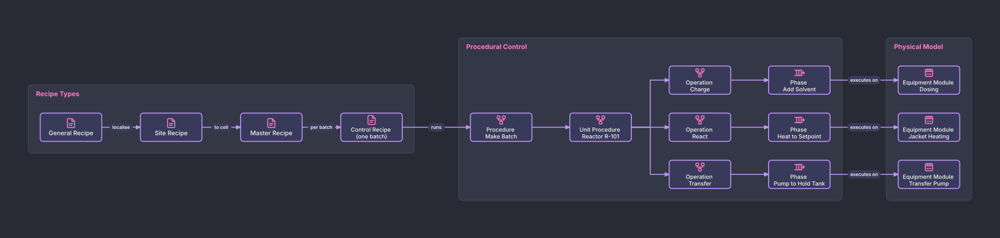

# Auto-Laid-Out ISA-88 Batch Recipe Hierarchy

## Bill of Materials

| Symbol / ID | Label | Kind | Group | Technical Notes / Metadata |
| :--- | :--- | :--- | :--- | :--- |
| `shape_2` | **General Recipe** | box | Recipe Types | - |
| `shape_3` | **Site Recipe** | box | Recipe Types | - |
| `shape_4` | **Master Recipe** | box | Recipe Types | - |
| `shape_5` | **Control Recipe (one batch)** | box | Recipe Types | - |
| `shape_7` | **Procedure Make Batch** | box | Procedural Control | - |
| `shape_8` | **Unit Procedure Reactor R-101** | box | Procedural Control | - |
| `shape_9` | **Operation Charge** | box | Procedural Control | - |
| `shape_10` | **Operation React** | box | Procedural Control | - |
| `shape_11` | **Phase Add Solvent** | box | Procedural Control | - |
| `shape_12` | **Operation Transfer** | box | Procedural Control | - |
| `shape_13` | **Phase Heat to Setpoint** | box | Procedural Control | - |
| `shape_14` | **Phase Pump to Hold Tank** | box | Procedural Control | - |
| `shape_16` | **Equipment Module Dosing** | box | Physical Model | - |
| `shape_17` | **Equipment Module Jacket Heating** | box | Physical Model | - |
| `shape_18` | **Equipment Module Transfer Pump** | box | Physical Model | - |

## Connections

| Source | Target | Protocol / Label | Style | Routing |
| :--- | :--- | :--- | :--- | :--- |
| **General Recipe** (`shape_2`) | **Site Recipe** (`shape_3`) | localise | solid | orthogonal |
| **Site Recipe** (`shape_3`) | **Master Recipe** (`shape_4`) | to cell | solid | orthogonal |
| **Master Recipe** (`shape_4`) | **Control Recipe (one batch)** (`shape_5`) | per batch | solid | orthogonal |
| **Control Recipe (one batch)** (`shape_5`) | **Procedure Make Batch** (`shape_7`) | runs | solid | orthogonal |
| **Procedure Make Batch** (`shape_7`) | **Unit Procedure Reactor R-101** (`shape_8`) | - | solid | orthogonal |
| **Unit Procedure Reactor R-101** (`shape_8`) | **Operation Charge** (`shape_9`) | - | solid | orthogonal |
| **Unit Procedure Reactor R-101** (`shape_8`) | **Operation React** (`shape_10`) | - | solid | orthogonal |
| **Unit Procedure Reactor R-101** (`shape_8`) | **Operation Transfer** (`shape_12`) | - | solid | orthogonal |
| **Operation Charge** (`shape_9`) | **Phase Add Solvent** (`shape_11`) | - | solid | orthogonal |
| **Operation Transfer** (`shape_12`) | **Phase Pump to Hold Tank** (`shape_14`) | - | solid | orthogonal |
| **Operation React** (`shape_10`) | **Phase Heat to Setpoint** (`shape_13`) | - | solid | orthogonal |
| **Phase Add Solvent** (`shape_11`) | **Equipment Module Dosing** (`shape_16`) | executes on | solid | orthogonal |
| **Phase Heat to Setpoint** (`shape_13`) | **Equipment Module Jacket Heating** (`shape_17`) | executes on | solid | orthogonal |
| **Phase Pump to Hold Tank** (`shape_14`) | **Equipment Module Transfer Pump** (`shape_18`) | executes on | solid | orthogonal |
