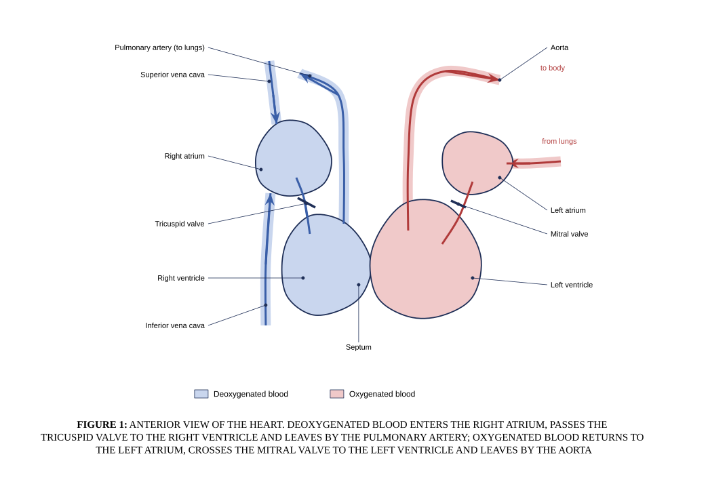

# Heart chambers and blood flow

## Bill of Materials

| Symbol / ID | Label | Kind | Group | Technical Notes / Metadata |
| :--- | :--- | :--- | :--- | :--- |

## Connections

| Source | Target | Protocol / Label | Style | Routing |
| :--- | :--- | :--- | :--- | :--- |
| **point_13** (`point_13`) | **point_14** (`point_14`) | - | solid | direct |
| **point_16** (`point_16`) | **point_17** (`point_17`) | - | solid | direct |
| **point_19** (`point_19`) | **point_20** (`point_20`) | - | solid | direct |
| **point_22** (`point_22`) | **point_23** (`point_23`) | - | solid | direct |
| **point_25** (`point_25`) | **point_26** (`point_26`) | - | solid | direct |
| **point_28** (`point_28`) | **point_29** (`point_29`) | - | solid | direct |
| **point_31** (`point_31`) | **point_32** (`point_32`) | - | solid | direct |
