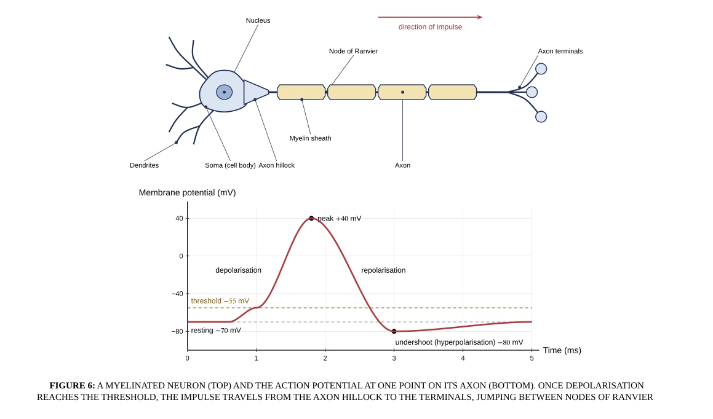

# Neuron and action potential

## Bill of Materials

| Symbol / ID | Label | Kind | Group | Technical Notes / Metadata |
| :--- | :--- | :--- | :--- | :--- |

## Connections

| Source | Target | Protocol / Label | Style | Routing |
| :--- | :--- | :--- | :--- | :--- |
| **point_22** (`point_22`) | **point_23** (`point_23`) | - | solid | direct |
| **point_50** (`point_50`) | **point_51** (`point_51`) | - | solid | direct |
| **point_52** (`point_52`) | **point_53** (`point_53`) | - | solid | direct |
