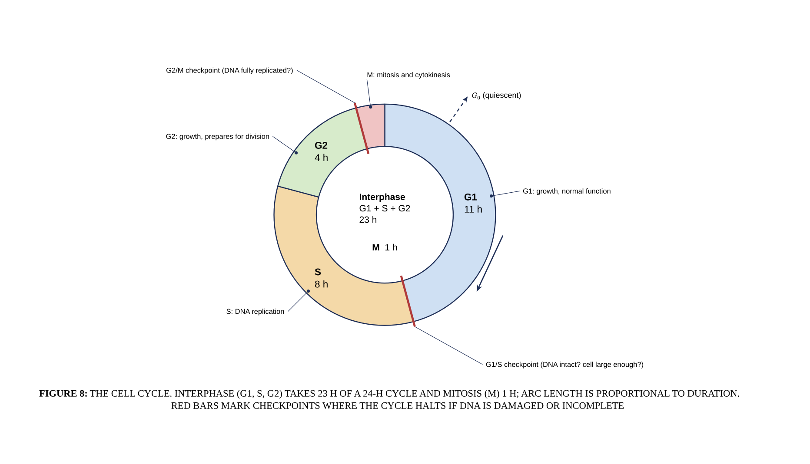

# Cell cycle

## Bill of Materials

| Symbol / ID | Label | Kind | Group | Technical Notes / Metadata |
| :--- | :--- | :--- | :--- | :--- |

## Connections

| Source | Target | Protocol / Label | Style | Routing |
| :--- | :--- | :--- | :--- | :--- |
| **point_10** (`point_10`) | **point_11** (`point_11`) | - | solid | direct |
| **point_30** (`point_30`) | **point_31** (`point_31`) | - | dashed | direct |
