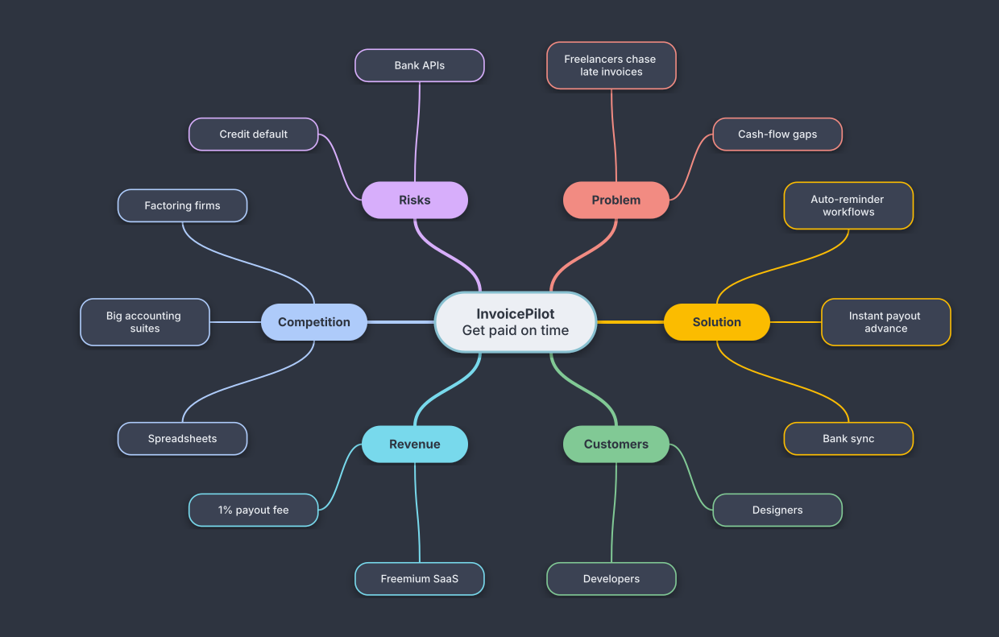

# Startup Idea Brainstorm Radial Mind Map

## Bill of Materials

| Symbol / ID | Label | Kind | Group | Technical Notes / Metadata |
| :--- | :--- | :--- | :--- | :--- |
| `shape_1` | ****InvoicePilot** Get paid on time** | box | - | - |
| `shape_2` | ****Problem**** | box | - | - |
| `shape_3` | **Freelancers chase late invoices** | box | - | - |
| `shape_4` | **Cash-flow gaps** | box | - | - |
| `shape_5` | ****Solution**** | box | - | - |
| `shape_6` | **Auto-reminder workflows** | box | - | - |
| `shape_7` | **Instant payout advance** | box | - | - |
| `shape_8` | **Bank sync** | box | - | - |
| `shape_9` | ****Customers**** | box | - | - |
| `shape_10` | **Designers** | box | - | - |
| `shape_11` | **Developers** | box | - | - |
| `shape_12` | ****Revenue**** | box | - | - |
| `shape_13` | **Freemium SaaS** | box | - | - |
| `shape_14` | **1% payout fee** | box | - | - |
| `shape_15` | ****Competition**** | box | - | - |
| `shape_16` | **Spreadsheets** | box | - | - |
| `shape_17` | **Big accounting suites** | box | - | - |
| `shape_18` | **Factoring firms** | box | - | - |
| `shape_19` | ****Risks**** | box | - | - |
| `shape_20` | **Credit default** | box | - | - |
| `shape_21` | **Bank APIs** | box | - | - |

## Connections

| Source | Target | Protocol / Label | Style | Routing |
| :--- | :--- | :--- | :--- | :--- |
| ****InvoicePilot** Get paid on time** (`shape_1`) | ****Problem**** (`shape_2`) | - | solid | curve |
| ****Problem**** (`shape_2`) | **Freelancers chase late invoices** (`shape_3`) | - | solid | curve |
| ****Problem**** (`shape_2`) | **Cash-flow gaps** (`shape_4`) | - | solid | curve |
| ****InvoicePilot** Get paid on time** (`shape_1`) | ****Solution**** (`shape_5`) | - | solid | curve |
| ****Solution**** (`shape_5`) | **Auto-reminder workflows** (`shape_6`) | - | solid | curve |
| ****Solution**** (`shape_5`) | **Instant payout advance** (`shape_7`) | - | solid | curve |
| ****Solution**** (`shape_5`) | **Bank sync** (`shape_8`) | - | solid | curve |
| ****InvoicePilot** Get paid on time** (`shape_1`) | ****Customers**** (`shape_9`) | - | solid | curve |
| ****Customers**** (`shape_9`) | **Designers** (`shape_10`) | - | solid | curve |
| ****Customers**** (`shape_9`) | **Developers** (`shape_11`) | - | solid | curve |
| ****InvoicePilot** Get paid on time** (`shape_1`) | ****Revenue**** (`shape_12`) | - | solid | curve |
| ****Revenue**** (`shape_12`) | **Freemium SaaS** (`shape_13`) | - | solid | curve |
| ****Revenue**** (`shape_12`) | **1% payout fee** (`shape_14`) | - | solid | curve |
| ****InvoicePilot** Get paid on time** (`shape_1`) | ****Competition**** (`shape_15`) | - | solid | curve |
| ****Competition**** (`shape_15`) | **Spreadsheets** (`shape_16`) | - | solid | curve |
| ****Competition**** (`shape_15`) | **Big accounting suites** (`shape_17`) | - | solid | curve |
| ****Competition**** (`shape_15`) | **Factoring firms** (`shape_18`) | - | solid | curve |
| ****InvoicePilot** Get paid on time** (`shape_1`) | ****Risks**** (`shape_19`) | - | solid | curve |
| ****Risks**** (`shape_19`) | **Credit default** (`shape_20`) | - | solid | curve |
| ****Risks**** (`shape_19`) | **Bank APIs** (`shape_21`) | - | solid | curve |
