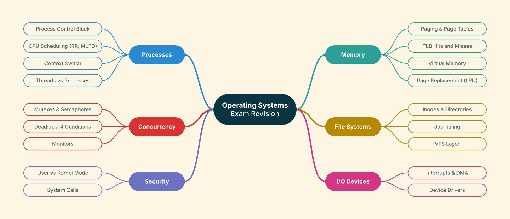

# Operating Systems Concepts Study Notes

## Bill of Materials

| Symbol / ID | Label | Kind | Group | Technical Notes / Metadata |
| :--- | :--- | :--- | :--- | :--- |
| `shape_1` | ****Operating Systems** Exam Revision** | box | - | - |
| `shape_2` | ****Processes**** | box | - | - |
| `shape_3` | **Process Control Block** | box | - | - |
| `shape_4` | **CPU Scheduling (RR, MLFQ)** | box | - | - |
| `shape_5` | **Context Switch** | box | - | - |
| `shape_6` | **Threads vs Processes** | box | - | - |
| `shape_7` | ****Concurrency**** | box | - | - |
| `shape_8` | **Mutexes & Semaphores** | box | - | - |
| `shape_9` | **Deadlock: 4 Conditions** | box | - | - |
| `shape_10` | **Monitors** | box | - | - |
| `shape_11` | ****Security**** | box | - | - |
| `shape_12` | **User vs Kernel Mode** | box | - | - |
| `shape_13` | **System Calls** | box | - | - |
| `shape_14` | ****Memory**** | box | - | - |
| `shape_15` | **Paging & Page Tables** | box | - | - |
| `shape_16` | **TLB Hits and Misses** | box | - | - |
| `shape_17` | **Virtual Memory** | box | - | - |
| `shape_18` | **Page Replacement (LRU)** | box | - | - |
| `shape_19` | ****File Systems**** | box | - | - |
| `shape_20` | **Inodes & Directories** | box | - | - |
| `shape_21` | **Journaling** | box | - | - |
| `shape_22` | **VFS Layer** | box | - | - |
| `shape_23` | ****I/O Devices**** | box | - | - |
| `shape_24` | **Interrupts & DMA** | box | - | - |
| `shape_25` | **Device Drivers** | box | - | - |

## Connections

| Source | Target | Protocol / Label | Style | Routing |
| :--- | :--- | :--- | :--- | :--- |
| ****Operating Systems** Exam Revision** (`shape_1`) | ****Processes**** (`shape_2`) | - | solid | curve |
| ****Processes**** (`shape_2`) | **Process Control Block** (`shape_3`) | - | solid | curve |
| ****Processes**** (`shape_2`) | **CPU Scheduling (RR, MLFQ)** (`shape_4`) | - | solid | curve |
| ****Processes**** (`shape_2`) | **Context Switch** (`shape_5`) | - | solid | curve |
| ****Processes**** (`shape_2`) | **Threads vs Processes** (`shape_6`) | - | solid | curve |
| ****Operating Systems** Exam Revision** (`shape_1`) | ****Concurrency**** (`shape_7`) | - | solid | curve |
| ****Concurrency**** (`shape_7`) | **Mutexes & Semaphores** (`shape_8`) | - | solid | curve |
| ****Concurrency**** (`shape_7`) | **Deadlock: 4 Conditions** (`shape_9`) | - | solid | curve |
| ****Concurrency**** (`shape_7`) | **Monitors** (`shape_10`) | - | solid | curve |
| ****Operating Systems** Exam Revision** (`shape_1`) | ****Security**** (`shape_11`) | - | solid | curve |
| ****Security**** (`shape_11`) | **User vs Kernel Mode** (`shape_12`) | - | solid | curve |
| ****Security**** (`shape_11`) | **System Calls** (`shape_13`) | - | solid | curve |
| ****Operating Systems** Exam Revision** (`shape_1`) | ****Memory**** (`shape_14`) | - | solid | curve |
| ****Memory**** (`shape_14`) | **Paging & Page Tables** (`shape_15`) | - | solid | curve |
| ****Memory**** (`shape_14`) | **TLB Hits and Misses** (`shape_16`) | - | solid | curve |
| ****Memory**** (`shape_14`) | **Virtual Memory** (`shape_17`) | - | solid | curve |
| ****Memory**** (`shape_14`) | **Page Replacement (LRU)** (`shape_18`) | - | solid | curve |
| ****Operating Systems** Exam Revision** (`shape_1`) | ****File Systems**** (`shape_19`) | - | solid | curve |
| ****File Systems**** (`shape_19`) | **Inodes & Directories** (`shape_20`) | - | solid | curve |
| ****File Systems**** (`shape_19`) | **Journaling** (`shape_21`) | - | solid | curve |
| ****File Systems**** (`shape_19`) | **VFS Layer** (`shape_22`) | - | solid | curve |
| ****Operating Systems** Exam Revision** (`shape_1`) | ****I/O Devices**** (`shape_23`) | - | solid | curve |
| ****I/O Devices**** (`shape_23`) | **Interrupts & DMA** (`shape_24`) | - | solid | curve |
| ****I/O Devices**** (`shape_23`) | **Device Drivers** (`shape_25`) | - | solid | curve |
