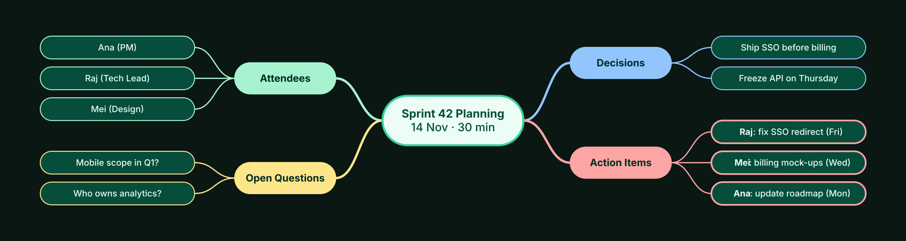

# Sprint 42 Planning Meeting Notes

## Bill of Materials

| Symbol / ID | Label | Kind | Group | Technical Notes / Metadata |
| :--- | :--- | :--- | :--- | :--- |
| `shape_1` | ****Sprint 42 Planning** 14 Nov · 30 min** | box | - | - |
| `shape_2` | ****Attendees**** | box | - | - |
| `shape_3` | **Ana (PM)** | box | - | - |
| `shape_4` | **Raj (Tech Lead)** | box | - | - |
| `shape_5` | **Mei (Design)** | box | - | - |
| `shape_6` | ****Open Questions**** | box | - | - |
| `shape_7` | **Mobile scope in Q1?** | box | - | - |
| `shape_8` | **Who owns analytics?** | box | - | - |
| `shape_9` | ****Decisions**** | box | - | - |
| `shape_10` | **Ship SSO before billing** | box | - | - |
| `shape_11` | **Freeze API on Thursday** | box | - | - |
| `shape_12` | ****Action Items**** | box | - | - |
| `shape_13` | ****Raj**: fix SSO redirect (Fri)** | box | - | - |
| `shape_14` | ****Mei**: billing mock-ups (Wed)** | box | - | - |
| `shape_15` | ****Ana**: update roadmap (Mon)** | box | - | - |

## Connections

| Source | Target | Protocol / Label | Style | Routing |
| :--- | :--- | :--- | :--- | :--- |
| ****Sprint 42 Planning** 14 Nov · 30 min** (`shape_1`) | ****Attendees**** (`shape_2`) | - | solid | curve |
| ****Attendees**** (`shape_2`) | **Ana (PM)** (`shape_3`) | - | solid | curve |
| ****Attendees**** (`shape_2`) | **Raj (Tech Lead)** (`shape_4`) | - | solid | curve |
| ****Attendees**** (`shape_2`) | **Mei (Design)** (`shape_5`) | - | solid | curve |
| ****Sprint 42 Planning** 14 Nov · 30 min** (`shape_1`) | ****Open Questions**** (`shape_6`) | - | solid | curve |
| ****Open Questions**** (`shape_6`) | **Mobile scope in Q1?** (`shape_7`) | - | solid | curve |
| ****Open Questions**** (`shape_6`) | **Who owns analytics?** (`shape_8`) | - | solid | curve |
| ****Sprint 42 Planning** 14 Nov · 30 min** (`shape_1`) | ****Decisions**** (`shape_9`) | - | solid | curve |
| ****Decisions**** (`shape_9`) | **Ship SSO before billing** (`shape_10`) | - | solid | curve |
| ****Decisions**** (`shape_9`) | **Freeze API on Thursday** (`shape_11`) | - | solid | curve |
| ****Sprint 42 Planning** 14 Nov · 30 min** (`shape_1`) | ****Action Items**** (`shape_12`) | - | solid | curve |
| ****Action Items**** (`shape_12`) | ****Raj**: fix SSO redirect (Fri)** (`shape_13`) | - | solid | curve |
| ****Action Items**** (`shape_12`) | ****Mei**: billing mock-ups (Wed)** (`shape_14`) | - | solid | curve |
| ****Action Items**** (`shape_12`) | ****Ana**: update roadmap (Mon)** (`shape_15`) | - | solid | curve |
