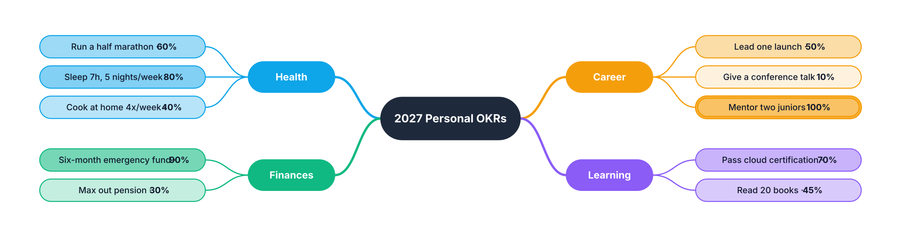

# Personal Goals and OKRs Mind Map

## Bill of Materials

| Symbol / ID | Label | Kind | Group | Technical Notes / Metadata |
| :--- | :--- | :--- | :--- | :--- |
| `shape_1` | ****2027 Personal OKRs**** | box | - | - |
| `shape_2` | ****Health**** | box | - | - |
| `shape_3` | **Run a half marathon · **60%**** | box | - | - |
| `shape_4` | **Sleep 7h, 5 nights/week · **80%**** | box | - | - |
| `shape_5` | **Cook at home 4x/week · **40%**** | box | - | - |
| `shape_6` | ****Finances**** | box | - | - |
| `shape_7` | **Six-month emergency fund · **90%**** | box | - | - |
| `shape_8` | **Max out pension · **30%**** | box | - | - |
| `shape_9` | ****Career**** | box | - | - |
| `shape_10` | **Lead one launch · **50%**** | box | - | - |
| `shape_11` | **Give a conference talk · **10%**** | box | - | - |
| `shape_12` | **Mentor two juniors · **100%**** | box | - | - |
| `shape_13` | ****Learning**** | box | - | - |
| `shape_14` | **Pass cloud certification · **70%**** | box | - | - |
| `shape_15` | **Read 20 books · **45%**** | box | - | - |

## Connections

| Source | Target | Protocol / Label | Style | Routing |
| :--- | :--- | :--- | :--- | :--- |
| ****2027 Personal OKRs**** (`shape_1`) | ****Health**** (`shape_2`) | - | solid | curve |
| ****Health**** (`shape_2`) | **Run a half marathon · **60%**** (`shape_3`) | - | solid | curve |
| ****Health**** (`shape_2`) | **Sleep 7h, 5 nights/week · **80%**** (`shape_4`) | - | solid | curve |
| ****Health**** (`shape_2`) | **Cook at home 4x/week · **40%**** (`shape_5`) | - | solid | curve |
| ****2027 Personal OKRs**** (`shape_1`) | ****Finances**** (`shape_6`) | - | solid | curve |
| ****Finances**** (`shape_6`) | **Six-month emergency fund · **90%**** (`shape_7`) | - | solid | curve |
| ****Finances**** (`shape_6`) | **Max out pension · **30%**** (`shape_8`) | - | solid | curve |
| ****2027 Personal OKRs**** (`shape_1`) | ****Career**** (`shape_9`) | - | solid | curve |
| ****Career**** (`shape_9`) | **Lead one launch · **50%**** (`shape_10`) | - | solid | curve |
| ****Career**** (`shape_9`) | **Give a conference talk · **10%**** (`shape_11`) | - | solid | curve |
| ****Career**** (`shape_9`) | **Mentor two juniors · **100%**** (`shape_12`) | - | solid | curve |
| ****2027 Personal OKRs**** (`shape_1`) | ****Learning**** (`shape_13`) | - | solid | curve |
| ****Learning**** (`shape_13`) | **Pass cloud certification · **70%**** (`shape_14`) | - | solid | curve |
| ****Learning**** (`shape_13`) | **Read 20 books · **45%**** (`shape_15`) | - | solid | curve |
