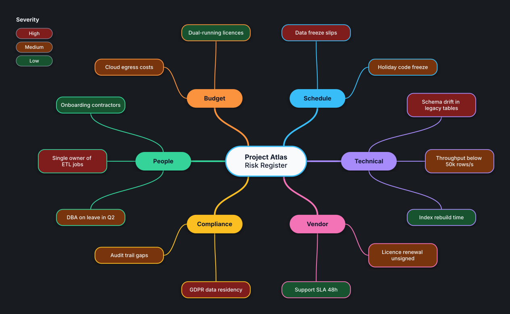

# Data Platform Migration Risk Register

## Bill of Materials

| Symbol / ID | Label | Kind | Group | Technical Notes / Metadata |
| :--- | :--- | :--- | :--- | :--- |
| `shape_1` | ****Project Atlas** Risk Register** | box | - | - |
| `shape_2` | ****Schedule**** | box | - | - |
| `shape_3` | **Data freeze slips** | box | - | - |
| `shape_4` | **Holiday code freeze** | box | - | - |
| `shape_5` | ****Technical**** | box | - | - |
| `shape_6` | **Schema drift in legacy tables** | box | - | - |
| `shape_7` | **Throughput below 50k rows/s** | box | - | - |
| `shape_8` | **Index rebuild time** | box | - | - |
| `shape_9` | ****Vendor**** | box | - | - |
| `shape_10` | **Licence renewal unsigned** | box | - | - |
| `shape_11` | **Support SLA 48h** | box | - | - |
| `shape_12` | ****Compliance**** | box | - | - |
| `shape_13` | **GDPR data residency** | box | - | - |
| `shape_14` | **Audit trail gaps** | box | - | - |
| `shape_15` | ****People**** | box | - | - |
| `shape_16` | **DBA on leave in Q2** | box | - | - |
| `shape_17` | **Single owner of ETL jobs** | box | - | - |
| `shape_18` | **Onboarding contractors** | box | - | - |
| `shape_19` | ****Budget**** | box | - | - |
| `shape_20` | **Cloud egress costs** | box | - | - |
| `shape_21` | **Dual-running licences** | box | - | - |
| `shape_23` | **High** | box | - | - |
| `shape_24` | **Medium** | box | - | - |
| `shape_25` | **Low** | box | - | - |

## Connections

| Source | Target | Protocol / Label | Style | Routing |
| :--- | :--- | :--- | :--- | :--- |
| ****Project Atlas** Risk Register** (`shape_1`) | ****Schedule**** (`shape_2`) | - | solid | curve |
| ****Schedule**** (`shape_2`) | **Data freeze slips** (`shape_3`) | - | solid | curve |
| ****Schedule**** (`shape_2`) | **Holiday code freeze** (`shape_4`) | - | solid | curve |
| ****Project Atlas** Risk Register** (`shape_1`) | ****Technical**** (`shape_5`) | - | solid | curve |
| ****Technical**** (`shape_5`) | **Schema drift in legacy tables** (`shape_6`) | - | solid | curve |
| ****Technical**** (`shape_5`) | **Throughput below 50k rows/s** (`shape_7`) | - | solid | curve |
| ****Technical**** (`shape_5`) | **Index rebuild time** (`shape_8`) | - | solid | curve |
| ****Project Atlas** Risk Register** (`shape_1`) | ****Vendor**** (`shape_9`) | - | solid | curve |
| ****Vendor**** (`shape_9`) | **Licence renewal unsigned** (`shape_10`) | - | solid | curve |
| ****Vendor**** (`shape_9`) | **Support SLA 48h** (`shape_11`) | - | solid | curve |
| ****Project Atlas** Risk Register** (`shape_1`) | ****Compliance**** (`shape_12`) | - | solid | curve |
| ****Compliance**** (`shape_12`) | **GDPR data residency** (`shape_13`) | - | solid | curve |
| ****Compliance**** (`shape_12`) | **Audit trail gaps** (`shape_14`) | - | solid | curve |
| ****Project Atlas** Risk Register** (`shape_1`) | ****People**** (`shape_15`) | - | solid | curve |
| ****People**** (`shape_15`) | **DBA on leave in Q2** (`shape_16`) | - | solid | curve |
| ****People**** (`shape_15`) | **Single owner of ETL jobs** (`shape_17`) | - | solid | curve |
| ****People**** (`shape_15`) | **Onboarding contractors** (`shape_18`) | - | solid | curve |
| ****Project Atlas** Risk Register** (`shape_1`) | ****Budget**** (`shape_19`) | - | solid | curve |
| ****Budget**** (`shape_19`) | **Cloud egress costs** (`shape_20`) | - | solid | curve |
| ****Budget**** (`shape_19`) | **Dual-running licences** (`shape_21`) | - | solid | curve |
