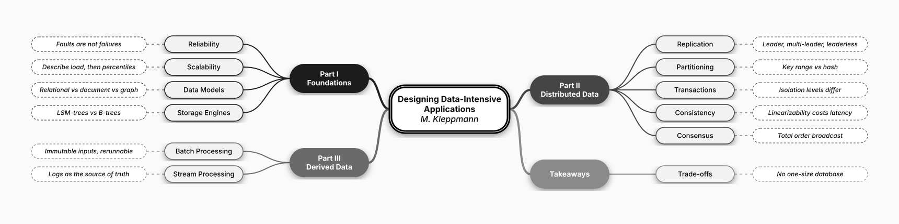

# Book Summary: Designing Data-Intensive Applications

## Bill of Materials

| Symbol / ID | Label | Kind | Group | Technical Notes / Metadata |
| :--- | :--- | :--- | :--- | :--- |
| `shape_1` | ****Designing Data-Intensive** **Applications** *M. Kleppmann*** | box | - | - |
| `shape_2` | ****Part I** **Foundations**** | box | - | - |
| `shape_3` | **Reliability** | box | - | - |
| `shape_4` | ***Faults are not failures*** | box | - | - |
| `shape_5` | **Scalability** | box | - | - |
| `shape_6` | ***Describe load, then percentiles*** | box | - | - |
| `shape_7` | **Data Models** | box | - | - |
| `shape_8` | ***Relational vs document vs graph*** | box | - | - |
| `shape_9` | **Storage Engines** | box | - | - |
| `shape_10` | ***LSM-trees vs B-trees*** | box | - | - |
| `shape_11` | ****Part III** **Derived Data**** | box | - | - |
| `shape_12` | **Batch Processing** | box | - | - |
| `shape_13` | ***Immutable inputs, rerunnable*** | box | - | - |
| `shape_14` | **Stream Processing** | box | - | - |
| `shape_15` | ***Logs as the source of truth*** | box | - | - |
| `shape_16` | ****Part II** **Distributed Data**** | box | - | - |
| `shape_17` | **Replication** | box | - | - |
| `shape_18` | ***Leader, multi-leader, leaderless*** | box | - | - |
| `shape_19` | **Partitioning** | box | - | - |
| `shape_20` | ***Key range vs hash*** | box | - | - |
| `shape_21` | **Transactions** | box | - | - |
| `shape_22` | ***Isolation levels differ*** | box | - | - |
| `shape_23` | **Consistency** | box | - | - |
| `shape_24` | ***Linearizability costs latency*** | box | - | - |
| `shape_25` | **Consensus** | box | - | - |
| `shape_26` | ***Total order broadcast*** | box | - | - |
| `shape_27` | ****Takeaways**** | box | - | - |
| `shape_28` | **Trade-offs** | box | - | - |
| `shape_29` | ***No one-size database*** | box | - | - |

## Connections

| Source | Target | Protocol / Label | Style | Routing |
| :--- | :--- | :--- | :--- | :--- |
| ****Designing Data-Intensive** **Applications** *M. Kleppmann*** (`shape_1`) | ****Part I** **Foundations**** (`shape_2`) | - | solid | curve |
| ****Part I** **Foundations**** (`shape_2`) | **Reliability** (`shape_3`) | - | solid | curve |
| **Reliability** (`shape_3`) | ***Faults are not failures*** (`shape_4`) | - | dashed | curve |
| ****Part I** **Foundations**** (`shape_2`) | **Scalability** (`shape_5`) | - | solid | curve |
| **Scalability** (`shape_5`) | ***Describe load, then percentiles*** (`shape_6`) | - | dashed | curve |
| ****Part I** **Foundations**** (`shape_2`) | **Data Models** (`shape_7`) | - | solid | curve |
| **Data Models** (`shape_7`) | ***Relational vs document vs graph*** (`shape_8`) | - | dashed | curve |
| ****Part I** **Foundations**** (`shape_2`) | **Storage Engines** (`shape_9`) | - | solid | curve |
| **Storage Engines** (`shape_9`) | ***LSM-trees vs B-trees*** (`shape_10`) | - | dashed | curve |
| ****Designing Data-Intensive** **Applications** *M. Kleppmann*** (`shape_1`) | ****Part III** **Derived Data**** (`shape_11`) | - | solid | curve |
| ****Part III** **Derived Data**** (`shape_11`) | **Batch Processing** (`shape_12`) | - | solid | curve |
| **Batch Processing** (`shape_12`) | ***Immutable inputs, rerunnable*** (`shape_13`) | - | dashed | curve |
| ****Part III** **Derived Data**** (`shape_11`) | **Stream Processing** (`shape_14`) | - | solid | curve |
| **Stream Processing** (`shape_14`) | ***Logs as the source of truth*** (`shape_15`) | - | dashed | curve |
| ****Designing Data-Intensive** **Applications** *M. Kleppmann*** (`shape_1`) | ****Part II** **Distributed Data**** (`shape_16`) | - | solid | curve |
| ****Part II** **Distributed Data**** (`shape_16`) | **Replication** (`shape_17`) | - | solid | curve |
| **Replication** (`shape_17`) | ***Leader, multi-leader, leaderless*** (`shape_18`) | - | dashed | curve |
| ****Part II** **Distributed Data**** (`shape_16`) | **Partitioning** (`shape_19`) | - | solid | curve |
| **Partitioning** (`shape_19`) | ***Key range vs hash*** (`shape_20`) | - | dashed | curve |
| ****Part II** **Distributed Data**** (`shape_16`) | **Transactions** (`shape_21`) | - | solid | curve |
| **Transactions** (`shape_21`) | ***Isolation levels differ*** (`shape_22`) | - | dashed | curve |
| ****Part II** **Distributed Data**** (`shape_16`) | **Consistency** (`shape_23`) | - | solid | curve |
| **Consistency** (`shape_23`) | ***Linearizability costs latency*** (`shape_24`) | - | dashed | curve |
| ****Part II** **Distributed Data**** (`shape_16`) | **Consensus** (`shape_25`) | - | solid | curve |
| **Consensus** (`shape_25`) | ***Total order broadcast*** (`shape_26`) | - | dashed | curve |
| ****Designing Data-Intensive** **Applications** *M. Kleppmann*** (`shape_1`) | ****Takeaways**** (`shape_27`) | - | solid | curve |
| ****Takeaways**** (`shape_27`) | **Trade-offs** (`shape_28`) | - | solid | curve |
| **Trade-offs** (`shape_28`) | ***No one-size database*** (`shape_29`) | - | dashed | curve |
