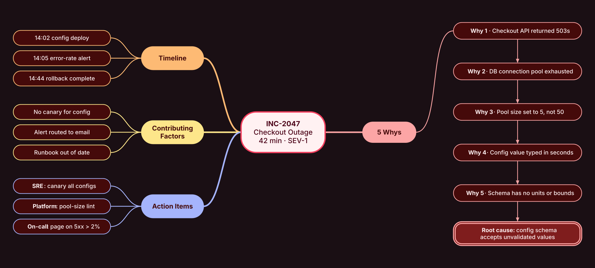

# Checkout Outage Incident Retrospective

## Bill of Materials

| Symbol / ID | Label | Kind | Group | Technical Notes / Metadata |
| :--- | :--- | :--- | :--- | :--- |
| `shape_1` | ****INC-2047** Checkout Outage 42 min · SEV-1** | box | - | - |
| `shape_2` | ****Timeline**** | box | - | - |
| `shape_3` | **14:02 config deploy** | box | - | - |
| `shape_4` | **14:05 error-rate alert** | box | - | - |
| `shape_5` | **14:44 rollback complete** | box | - | - |
| `shape_6` | ****Contributing** **Factors**** | box | - | - |
| `shape_7` | **No canary for config** | box | - | - |
| `shape_8` | **Alert routed to email** | box | - | - |
| `shape_9` | **Runbook out of date** | box | - | - |
| `shape_10` | ****Action Items**** | box | - | - |
| `shape_11` | ****SRE**: canary all configs** | box | - | - |
| `shape_12` | ****Platform**: pool-size lint** | box | - | - |
| `shape_13` | ****On-call**: page on 5xx > 2%** | box | - | - |
| `shape_14` | ****5 Whys**** | box | - | - |
| `shape_15` | ****Why 1** · Checkout API returned 503s** | box | - | - |
| `shape_16` | ****Why 2** · DB connection pool exhausted** | box | - | - |
| `shape_17` | ****Why 3** · Pool size set to 5, not 50** | box | - | - |
| `shape_18` | ****Why 4** · Config value typed in seconds** | box | - | - |
| `shape_19` | ****Why 5** · Schema has no units or bounds** | box | - | - |
| `shape_20` | ****Root cause:** config schema accepts unvalidated values** | box | - | - |

## Connections

| Source | Target | Protocol / Label | Style | Routing |
| :--- | :--- | :--- | :--- | :--- |
| ****INC-2047** Checkout Outage 42 min · SEV-1** (`shape_1`) | ****Timeline**** (`shape_2`) | - | solid | curve |
| ****Timeline**** (`shape_2`) | **14:02 config deploy** (`shape_3`) | - | solid | curve |
| ****Timeline**** (`shape_2`) | **14:05 error-rate alert** (`shape_4`) | - | solid | curve |
| ****Timeline**** (`shape_2`) | **14:44 rollback complete** (`shape_5`) | - | solid | curve |
| ****INC-2047** Checkout Outage 42 min · SEV-1** (`shape_1`) | ****Contributing** **Factors**** (`shape_6`) | - | solid | curve |
| ****Contributing** **Factors**** (`shape_6`) | **No canary for config** (`shape_7`) | - | solid | curve |
| ****Contributing** **Factors**** (`shape_6`) | **Alert routed to email** (`shape_8`) | - | solid | curve |
| ****Contributing** **Factors**** (`shape_6`) | **Runbook out of date** (`shape_9`) | - | solid | curve |
| ****INC-2047** Checkout Outage 42 min · SEV-1** (`shape_1`) | ****Action Items**** (`shape_10`) | - | solid | curve |
| ****Action Items**** (`shape_10`) | ****SRE**: canary all configs** (`shape_11`) | - | solid | curve |
| ****Action Items**** (`shape_10`) | ****Platform**: pool-size lint** (`shape_12`) | - | solid | curve |
| ****Action Items**** (`shape_10`) | ****On-call**: page on 5xx > 2%** (`shape_13`) | - | solid | curve |
| ****INC-2047** Checkout Outage 42 min · SEV-1** (`shape_1`) | ****5 Whys**** (`shape_14`) | - | solid | curve |
| ****5 Whys**** (`shape_14`) | ****Why 1** · Checkout API returned 503s** (`shape_15`) | - | solid | curve |
| ****Why 1** · Checkout API returned 503s** (`shape_15`) | ****Why 2** · DB connection pool exhausted** (`shape_16`) | - | solid | direct |
| ****Why 2** · DB connection pool exhausted** (`shape_16`) | ****Why 3** · Pool size set to 5, not 50** (`shape_17`) | - | solid | direct |
| ****Why 3** · Pool size set to 5, not 50** (`shape_17`) | ****Why 4** · Config value typed in seconds** (`shape_18`) | - | solid | direct |
| ****Why 4** · Config value typed in seconds** (`shape_18`) | ****Why 5** · Schema has no units or bounds** (`shape_19`) | - | solid | direct |
| ****Why 5** · Schema has no units or bounds** (`shape_19`) | ****Root cause:** config schema accepts unvalidated values** (`shape_20`) | - | solid | direct |
