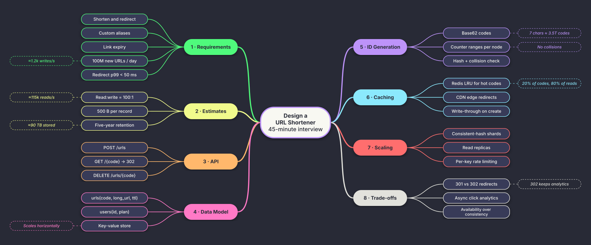

# System Design Interview: URL Shortener Breakdown

## Bill of Materials

| Symbol / ID | Label | Kind | Group | Technical Notes / Metadata |
| :--- | :--- | :--- | :--- | :--- |
| `shape_1` | ****Design a** **URL Shortener** 45-minute interview** | box | - | - |
| `shape_2` | ****1 · Requirements**** | box | - | - |
| `shape_3` | **Shorten and redirect** | box | - | - |
| `shape_4` | **Custom aliases** | box | - | - |
| `shape_5` | **Link expiry** | box | - | - |
| `shape_6` | **100M new URLs / day** | box | - | - |
| `shape_7` | ***≈1.2k writes/s*** | box | - | - |
| `shape_8` | **Redirect p99 < 50 ms** | box | - | - |
| `shape_9` | ****2 · Estimates**** | box | - | - |
| `shape_10` | **Read:write = 100:1** | box | - | - |
| `shape_11` | ***≈115k reads/s*** | box | - | - |
| `shape_12` | **500 B per record** | box | - | - |
| `shape_13` | **Five-year retention** | box | - | - |
| `shape_14` | ***≈90 TB stored*** | box | - | - |
| `shape_15` | ****3 · API**** | box | - | - |
| `shape_16` | **POST /urls** | box | - | - |
| `shape_17` | **GET /{code} → 302** | box | - | - |
| `shape_18` | **DELETE /urls/{code}** | box | - | - |
| `shape_19` | ****4 · Data Model**** | box | - | - |
| `shape_20` | **urls(code, long_url, ttl)** | box | - | - |
| `shape_21` | **users(id, plan)** | box | - | - |
| `shape_22` | **Key-value store** | box | - | - |
| `shape_23` | ***Scales horizontally*** | box | - | - |
| `shape_24` | ****5 · ID Generation**** | box | - | - |
| `shape_25` | **Base62 codes** | box | - | - |
| `shape_26` | ***7 chars ≈ 3.5T codes*** | box | - | - |
| `shape_27` | **Counter ranges per node** | box | - | - |
| `shape_28` | ***No collisions*** | box | - | - |
| `shape_29` | **Hash + collision check** | box | - | - |
| `shape_30` | ****6 · Caching**** | box | - | - |
| `shape_31` | **Redis LRU for hot codes** | box | - | - |
| `shape_32` | ***20% of codes, 80% of reads*** | box | - | - |
| `shape_33` | **CDN edge redirects** | box | - | - |
| `shape_34` | **Write-through on create** | box | - | - |
| `shape_35` | ****7 · Scaling**** | box | - | - |
| `shape_36` | **Consistent-hash shards** | box | - | - |
| `shape_37` | **Read replicas** | box | - | - |
| `shape_38` | **Per-key rate limiting** | box | - | - |
| `shape_39` | ****8 · Trade-offs**** | box | - | - |
| `shape_40` | **301 vs 302 redirects** | box | - | - |
| `shape_41` | ***302 keeps analytics*** | box | - | - |
| `shape_42` | **Async click analytics** | box | - | - |
| `shape_43` | **Availability over consistency** | box | - | - |

## Connections

| Source | Target | Protocol / Label | Style | Routing |
| :--- | :--- | :--- | :--- | :--- |
| ****Design a** **URL Shortener** 45-minute interview** (`shape_1`) | ****1 · Requirements**** (`shape_2`) | - | solid | curve |
| ****1 · Requirements**** (`shape_2`) | **Shorten and redirect** (`shape_3`) | - | solid | curve |
| ****1 · Requirements**** (`shape_2`) | **Custom aliases** (`shape_4`) | - | solid | curve |
| ****1 · Requirements**** (`shape_2`) | **Link expiry** (`shape_5`) | - | solid | curve |
| ****1 · Requirements**** (`shape_2`) | **100M new URLs / day** (`shape_6`) | - | solid | curve |
| **100M new URLs / day** (`shape_6`) | ***≈1.2k writes/s*** (`shape_7`) | - | dashed | curve |
| ****1 · Requirements**** (`shape_2`) | **Redirect p99 < 50 ms** (`shape_8`) | - | solid | curve |
| ****Design a** **URL Shortener** 45-minute interview** (`shape_1`) | ****2 · Estimates**** (`shape_9`) | - | solid | curve |
| ****2 · Estimates**** (`shape_9`) | **Read:write = 100:1** (`shape_10`) | - | solid | curve |
| **Read:write = 100:1** (`shape_10`) | ***≈115k reads/s*** (`shape_11`) | - | dashed | curve |
| ****2 · Estimates**** (`shape_9`) | **500 B per record** (`shape_12`) | - | solid | curve |
| ****2 · Estimates**** (`shape_9`) | **Five-year retention** (`shape_13`) | - | solid | curve |
| **Five-year retention** (`shape_13`) | ***≈90 TB stored*** (`shape_14`) | - | dashed | curve |
| ****Design a** **URL Shortener** 45-minute interview** (`shape_1`) | ****3 · API**** (`shape_15`) | - | solid | curve |
| ****3 · API**** (`shape_15`) | **POST /urls** (`shape_16`) | - | solid | curve |
| ****3 · API**** (`shape_15`) | **GET /{code} → 302** (`shape_17`) | - | solid | curve |
| ****3 · API**** (`shape_15`) | **DELETE /urls/{code}** (`shape_18`) | - | solid | curve |
| ****Design a** **URL Shortener** 45-minute interview** (`shape_1`) | ****4 · Data Model**** (`shape_19`) | - | solid | curve |
| ****4 · Data Model**** (`shape_19`) | **urls(code, long_url, ttl)** (`shape_20`) | - | solid | curve |
| ****4 · Data Model**** (`shape_19`) | **users(id, plan)** (`shape_21`) | - | solid | curve |
| ****4 · Data Model**** (`shape_19`) | **Key-value store** (`shape_22`) | - | solid | curve |
| **Key-value store** (`shape_22`) | ***Scales horizontally*** (`shape_23`) | - | dashed | curve |
| ****Design a** **URL Shortener** 45-minute interview** (`shape_1`) | ****5 · ID Generation**** (`shape_24`) | - | solid | curve |
| ****5 · ID Generation**** (`shape_24`) | **Base62 codes** (`shape_25`) | - | solid | curve |
| **Base62 codes** (`shape_25`) | ***7 chars ≈ 3.5T codes*** (`shape_26`) | - | dashed | curve |
| ****5 · ID Generation**** (`shape_24`) | **Counter ranges per node** (`shape_27`) | - | solid | curve |
| **Counter ranges per node** (`shape_27`) | ***No collisions*** (`shape_28`) | - | dashed | curve |
| ****5 · ID Generation**** (`shape_24`) | **Hash + collision check** (`shape_29`) | - | solid | curve |
| ****Design a** **URL Shortener** 45-minute interview** (`shape_1`) | ****6 · Caching**** (`shape_30`) | - | solid | curve |
| ****6 · Caching**** (`shape_30`) | **Redis LRU for hot codes** (`shape_31`) | - | solid | curve |
| **Redis LRU for hot codes** (`shape_31`) | ***20% of codes, 80% of reads*** (`shape_32`) | - | dashed | curve |
| ****6 · Caching**** (`shape_30`) | **CDN edge redirects** (`shape_33`) | - | solid | curve |
| ****6 · Caching**** (`shape_30`) | **Write-through on create** (`shape_34`) | - | solid | curve |
| ****Design a** **URL Shortener** 45-minute interview** (`shape_1`) | ****7 · Scaling**** (`shape_35`) | - | solid | curve |
| ****7 · Scaling**** (`shape_35`) | **Consistent-hash shards** (`shape_36`) | - | solid | curve |
| ****7 · Scaling**** (`shape_35`) | **Read replicas** (`shape_37`) | - | solid | curve |
| ****7 · Scaling**** (`shape_35`) | **Per-key rate limiting** (`shape_38`) | - | solid | curve |
| ****Design a** **URL Shortener** 45-minute interview** (`shape_1`) | ****8 · Trade-offs**** (`shape_39`) | - | solid | curve |
| ****8 · Trade-offs**** (`shape_39`) | **301 vs 302 redirects** (`shape_40`) | - | solid | curve |
| **301 vs 302 redirects** (`shape_40`) | ***302 keeps analytics*** (`shape_41`) | - | dashed | curve |
| ****8 · Trade-offs**** (`shape_39`) | **Async click analytics** (`shape_42`) | - | solid | curve |
| ****8 · Trade-offs**** (`shape_39`) | **Availability over consistency** (`shape_43`) | - | solid | curve |
