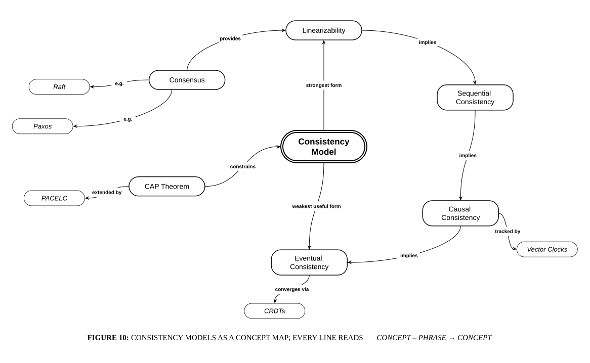

# Distributed Consistency Concept Map

## Bill of Materials

| Symbol / ID | Label | Kind | Group | Technical Notes / Metadata |
| :--- | :--- | :--- | :--- | :--- |
| `shape_1` | ****Consistency** **Model**** | box | - | - |
| `shape_2` | **Linearizability** | box | - | - |
| `shape_3` | **Sequential Consistency** | box | - | - |
| `shape_4` | **Causal Consistency** | box | - | - |
| `shape_5` | **Eventual Consistency** | box | - | - |
| `shape_6` | **CAP Theorem** | box | - | - |
| `shape_7` | **Consensus** | box | - | - |
| `shape_8` | ***Raft*** | box | - | - |
| `shape_9` | ***Paxos*** | box | - | - |
| `shape_10` | ***Vector Clocks*** | box | - | - |
| `shape_11` | ***CRDTs*** | box | - | - |
| `shape_12` | ***PACELC*** | box | - | - |

## Connections

| Source | Target | Protocol / Label | Style | Routing |
| :--- | :--- | :--- | :--- | :--- |
| ****Consistency** **Model**** (`shape_1`) | **Linearizability** (`shape_2`) | strongest form | solid | curve |
| ****Consistency** **Model**** (`shape_1`) | **Eventual Consistency** (`shape_5`) | weakest useful form | solid | curve |
| **Linearizability** (`shape_2`) | **Sequential Consistency** (`shape_3`) | implies | solid | curve |
| **Sequential Consistency** (`shape_3`) | **Causal Consistency** (`shape_4`) | implies | solid | curve |
| **Causal Consistency** (`shape_4`) | **Eventual Consistency** (`shape_5`) | implies | solid | curve |
| **CAP Theorem** (`shape_6`) | ****Consistency** **Model**** (`shape_1`) | constrains | solid | curve |
| **Consensus** (`shape_7`) | **Linearizability** (`shape_2`) | provides | solid | curve |
| **Consensus** (`shape_7`) | ***Paxos*** (`shape_9`) | e.g. | solid | curve |
| **Consensus** (`shape_7`) | ***Raft*** (`shape_8`) | e.g. | solid | curve |
| **Causal Consistency** (`shape_4`) | ***Vector Clocks*** (`shape_10`) | tracked by | solid | curve |
| **Eventual Consistency** (`shape_5`) | ***CRDTs*** (`shape_11`) | converges via | solid | curve |
| **CAP Theorem** (`shape_6`) | ***PACELC*** (`shape_12`) | extended by | solid | curve |
