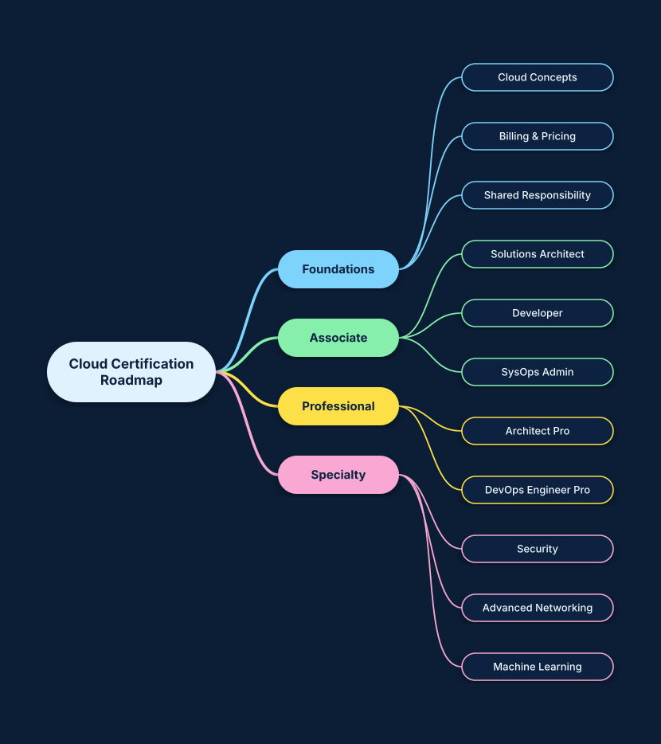

# Auto-Laid-Out Cloud Certification Roadmap

## Bill of Materials

| Symbol / ID | Label | Kind | Group | Technical Notes / Metadata |
| :--- | :--- | :--- | :--- | :--- |
| `shape_1` | ****Cloud Certification** **Roadmap**** | box | - | - |
| `shape_2` | ****Foundations**** | box | - | - |
| `shape_3` | **Cloud Concepts** | box | - | - |
| `shape_4` | **Billing & Pricing** | box | - | - |
| `shape_5` | **Shared Responsibility** | box | - | - |
| `shape_6` | ****Associate**** | box | - | - |
| `shape_7` | **Solutions Architect** | box | - | - |
| `shape_8` | **Developer** | box | - | - |
| `shape_9` | **SysOps Admin** | box | - | - |
| `shape_10` | ****Professional**** | box | - | - |
| `shape_11` | **Architect Pro** | box | - | - |
| `shape_12` | **DevOps Engineer Pro** | box | - | - |
| `shape_13` | ****Specialty**** | box | - | - |
| `shape_14` | **Security** | box | - | - |
| `shape_15` | **Advanced Networking** | box | - | - |
| `shape_16` | **Machine Learning** | box | - | - |

## Connections

| Source | Target | Protocol / Label | Style | Routing |
| :--- | :--- | :--- | :--- | :--- |
| ****Cloud Certification** **Roadmap**** (`shape_1`) | ****Foundations**** (`shape_2`) | - | solid | curve |
| ****Foundations**** (`shape_2`) | **Cloud Concepts** (`shape_3`) | - | solid | curve |
| ****Foundations**** (`shape_2`) | **Billing & Pricing** (`shape_4`) | - | solid | curve |
| ****Foundations**** (`shape_2`) | **Shared Responsibility** (`shape_5`) | - | solid | curve |
| ****Cloud Certification** **Roadmap**** (`shape_1`) | ****Associate**** (`shape_6`) | - | solid | curve |
| ****Associate**** (`shape_6`) | **Solutions Architect** (`shape_7`) | - | solid | curve |
| ****Associate**** (`shape_6`) | **Developer** (`shape_8`) | - | solid | curve |
| ****Associate**** (`shape_6`) | **SysOps Admin** (`shape_9`) | - | solid | curve |
| ****Cloud Certification** **Roadmap**** (`shape_1`) | ****Professional**** (`shape_10`) | - | solid | curve |
| ****Professional**** (`shape_10`) | **Architect Pro** (`shape_11`) | - | solid | curve |
| ****Professional**** (`shape_10`) | **DevOps Engineer Pro** (`shape_12`) | - | solid | curve |
| ****Cloud Certification** **Roadmap**** (`shape_1`) | ****Specialty**** (`shape_13`) | - | solid | curve |
| ****Specialty**** (`shape_13`) | **Security** (`shape_14`) | - | solid | curve |
| ****Specialty**** (`shape_13`) | **Advanced Networking** (`shape_15`) | - | solid | curve |
| ****Specialty**** (`shape_13`) | **Machine Learning** (`shape_16`) | - | solid | curve |
