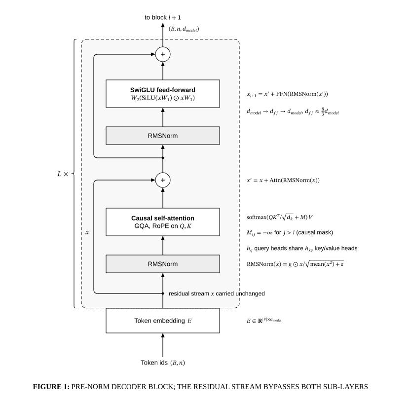

# Pre-norm decoder block

## Bill of Materials

| Symbol / ID | Label | Kind | Group | Technical Notes / Metadata |
| :--- | :--- | :--- | :--- | :--- |
| `shape_1` | **** | box | - | - |
| `shape_2` | **+** | box | - | - |
| `shape_3` | ****SwiGLU feed-forward** $W_2(\mathrm{SiLU}(x W_1) \odot x W_3)$** | box | - | - |
| `shape_4` | **RMSNorm** | box | - | - |
| `shape_5` | **+** | box | - | - |
| `shape_6` | ****Causal self-attention** GQA, RoPE on $Q, K$** | box | - | - |
| `shape_7` | **RMSNorm** | box | - | - |
| `shape_8` | **Token embedding $E$** | box | - | - |

## Connections

| Source | Target | Protocol / Label | Style | Routing |
| :--- | :--- | :--- | :--- | :--- |
| **Token ids $(B, n)$** (`text_9`) | **Token embedding $E$** (`shape_8`) | - | solid | orthogonal |
| **Token embedding $E$** (`shape_8`) | **RMSNorm** (`shape_7`) | - | solid | orthogonal |
| **RMSNorm** (`shape_7`) | ****Causal self-attention** GQA, RoPE on $Q, K$** (`shape_6`) | - | solid | orthogonal |
| ****Causal self-attention** GQA, RoPE on $Q, K$** (`shape_6`) | **+** (`shape_5`) | - | solid | orthogonal |
| **+** (`shape_5`) | **RMSNorm** (`shape_4`) | - | solid | orthogonal |
| **RMSNorm** (`shape_4`) | ****SwiGLU feed-forward** $W_2(\mathrm{SiLU}(x W_1) \odot x W_3)$** (`shape_3`) | - | solid | orthogonal |
| ****SwiGLU feed-forward** $W_2(\mathrm{SiLU}(x W_1) \odot x W_3)$** (`shape_3`) | **+** (`shape_2`) | - | solid | orthogonal |
| **+** (`shape_2`) | **to block $l + 1$** (`text_10`) | - | solid | orthogonal |
| **point_11** (`point_11`) | **+** (`shape_5`) | - | solid | orthogonal |
| **point_12** (`point_12`) | **+** (`shape_2`) | - | solid | orthogonal |
