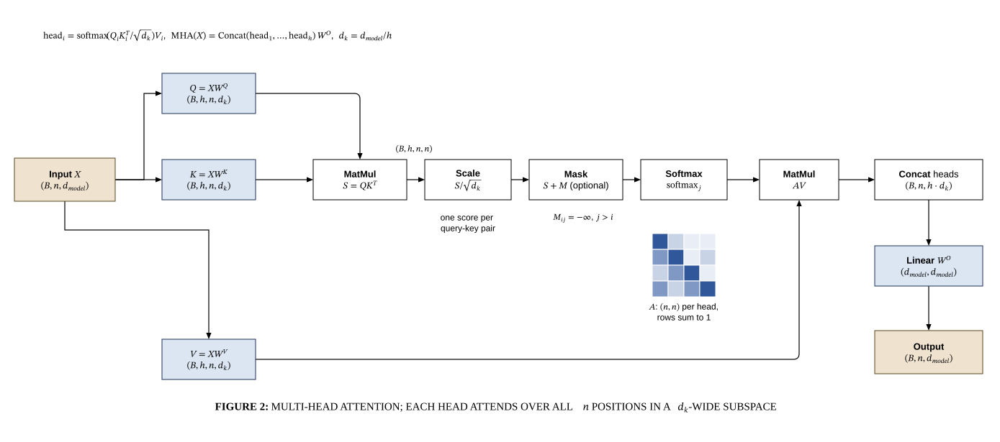

# Multi-head scaled dot-product attention

## Bill of Materials

| Symbol / ID | Label | Kind | Group | Technical Notes / Metadata |
| :--- | :--- | :--- | :--- | :--- |
| `shape_1` | ****Input** $X$ $(B, n, d_{model})$** | box | - | - |
| `shape_2` | **$Q = X W^Q$ $(B, h, n, d_k)$** | box | - | - |
| `shape_3` | **$K = X W^K$ $(B, h, n, d_k)$** | box | - | - |
| `shape_4` | **$V = X W^V$ $(B, h, n, d_k)$** | box | - | - |
| `shape_5` | ****MatMul** $S = QK^T$** | box | - | - |
| `shape_6` | ****Scale** $S / \sqrt{d_k}$** | box | - | - |
| `shape_7` | ****Mask** $S + M$ (optional)** | box | - | - |
| `shape_8` | ****Softmax** $\mathrm{softmax}_j$** | box | - | - |
| `shape_9` | ****MatMul** $A V$** | box | - | - |
| `shape_10` | ****Concat** heads $(B, n, h \cdot d_k)$** | box | - | - |
| `shape_11` | ****Linear** $W^O$ $(d_{model}, d_{model})$** | box | - | - |
| `shape_12` | ****Output** $(B, n, d_{model})$** | box | - | - |
| `shape_16` | **** | box | - | - |
| `shape_17` | **** | box | - | - |
| `shape_18` | **** | box | - | - |
| `shape_19` | **** | box | - | - |
| `shape_20` | **** | box | - | - |
| `shape_21` | **** | box | - | - |
| `shape_22` | **** | box | - | - |
| `shape_23` | **** | box | - | - |
| `shape_24` | **** | box | - | - |
| `shape_25` | **** | box | - | - |
| `shape_26` | **** | box | - | - |
| `shape_27` | **** | box | - | - |
| `shape_28` | **** | box | - | - |
| `shape_29` | **** | box | - | - |
| `shape_30` | **** | box | - | - |
| `shape_31` | **** | box | - | - |

## Connections

| Source | Target | Protocol / Label | Style | Routing |
| :--- | :--- | :--- | :--- | :--- |
| ****Input** $X$ $(B, n, d_{model})$** (`shape_1`) | **$Q = X W^Q$ $(B, h, n, d_k)$** (`shape_2`) | - | solid | orthogonal |
| ****Input** $X$ $(B, n, d_{model})$** (`shape_1`) | **$K = X W^K$ $(B, h, n, d_k)$** (`shape_3`) | - | solid | orthogonal |
| ****Input** $X$ $(B, n, d_{model})$** (`shape_1`) | **$V = X W^V$ $(B, h, n, d_k)$** (`shape_4`) | - | solid | orthogonal |
| **$Q = X W^Q$ $(B, h, n, d_k)$** (`shape_2`) | ****MatMul** $S = QK^T$** (`shape_5`) | - | solid | orthogonal |
| **$K = X W^K$ $(B, h, n, d_k)$** (`shape_3`) | ****MatMul** $S = QK^T$** (`shape_5`) | - | solid | orthogonal |
| ****MatMul** $S = QK^T$** (`shape_5`) | ****Scale** $S / \sqrt{d_k}$** (`shape_6`) | - | solid | orthogonal |
| ****Scale** $S / \sqrt{d_k}$** (`shape_6`) | ****Mask** $S + M$ (optional)** (`shape_7`) | - | solid | orthogonal |
| ****Mask** $S + M$ (optional)** (`shape_7`) | ****Softmax** $\mathrm{softmax}_j$** (`shape_8`) | - | solid | orthogonal |
| ****Softmax** $\mathrm{softmax}_j$** (`shape_8`) | ****MatMul** $A V$** (`shape_9`) | - | solid | orthogonal |
| **$V = X W^V$ $(B, h, n, d_k)$** (`shape_4`) | ****MatMul** $A V$** (`shape_9`) | - | solid | orthogonal |
| ****MatMul** $A V$** (`shape_9`) | ****Concat** heads $(B, n, h \cdot d_k)$** (`shape_10`) | - | solid | orthogonal |
| ****Concat** heads $(B, n, h \cdot d_k)$** (`shape_10`) | ****Linear** $W^O$ $(d_{model}, d_{model})$** (`shape_11`) | - | solid | orthogonal |
| ****Linear** $W^O$ $(d_{model}, d_{model})$** (`shape_11`) | ****Output** $(B, n, d_{model})$** (`shape_12`) | - | solid | orthogonal |
