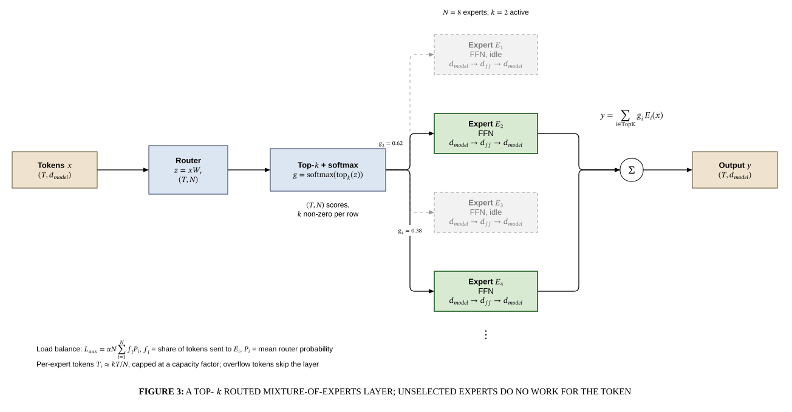

# Mixture-of-experts layer

## Bill of Materials

| Symbol / ID | Label | Kind | Group | Technical Notes / Metadata |
| :--- | :--- | :--- | :--- | :--- |
| `shape_1` | ****Tokens** $x$ $(T, d_{model})$** | box | - | - |
| `shape_2` | ****Router** $z = x W_r$ $(T, N)$** | box | - | - |
| `shape_3` | ****Top-$k$ + softmax** $g = \mathrm{softmax}(\mathrm{top}_k(z))$** | box | - | - |
| `shape_4` | ****Expert** $E_{1}$ FFN, idle $d_{model} \to d_{ff} \to d_{model}$** | box | - | - |
| `shape_5` | ****Expert** $E_{2}$ FFN $d_{model} \to d_{ff} \to d_{model}$** | box | - | - |
| `shape_6` | ****Expert** $E_{3}$ FFN, idle $d_{model} \to d_{ff} \to d_{model}$** | box | - | - |
| `shape_7` | ****Expert** $E_{4}$ FFN $d_{model} \to d_{ff} \to d_{model}$** | box | - | - |
| `shape_10` | **$\Sigma$** | box | - | - |
| `shape_11` | ****Output** $y$ $(T, d_{model})$** | box | - | - |

## Connections

| Source | Target | Protocol / Label | Style | Routing |
| :--- | :--- | :--- | :--- | :--- |
| ****Tokens** $x$ $(T, d_{model})$** (`shape_1`) | ****Router** $z = x W_r$ $(T, N)$** (`shape_2`) | - | solid | orthogonal |
| ****Router** $z = x W_r$ $(T, N)$** (`shape_2`) | ****Top-$k$ + softmax** $g = \mathrm{softmax}(\mathrm{top}_k(z))$** (`shape_3`) | - | solid | orthogonal |
| ****Top-$k$ + softmax** $g = \mathrm{softmax}(\mathrm{top}_k(z))$** (`shape_3`) | ****Expert** $E_{1}$ FFN, idle $d_{model} \to d_{ff} \to d_{model}$** (`shape_4`) | - | dashed | orthogonal |
| ****Top-$k$ + softmax** $g = \mathrm{softmax}(\mathrm{top}_k(z))$** (`shape_3`) | ****Expert** $E_{2}$ FFN $d_{model} \to d_{ff} \to d_{model}$** (`shape_5`) | $g_2 = 0.62$ | solid | orthogonal |
| ****Expert** $E_{2}$ FFN $d_{model} \to d_{ff} \to d_{model}$** (`shape_5`) | **$\Sigma$** (`shape_10`) | - | solid | orthogonal |
| ****Top-$k$ + softmax** $g = \mathrm{softmax}(\mathrm{top}_k(z))$** (`shape_3`) | ****Expert** $E_{3}$ FFN, idle $d_{model} \to d_{ff} \to d_{model}$** (`shape_6`) | - | dashed | orthogonal |
| ****Top-$k$ + softmax** $g = \mathrm{softmax}(\mathrm{top}_k(z))$** (`shape_3`) | ****Expert** $E_{4}$ FFN $d_{model} \to d_{ff} \to d_{model}$** (`shape_7`) | $g_4 = 0.38$ | solid | orthogonal |
| ****Expert** $E_{4}$ FFN $d_{model} \to d_{ff} \to d_{model}$** (`shape_7`) | **$\Sigma$** (`shape_10`) | - | solid | orthogonal |
| **$\Sigma$** (`shape_10`) | ****Output** $y$ $(T, d_{model})$** (`shape_11`) | - | solid | orthogonal |
