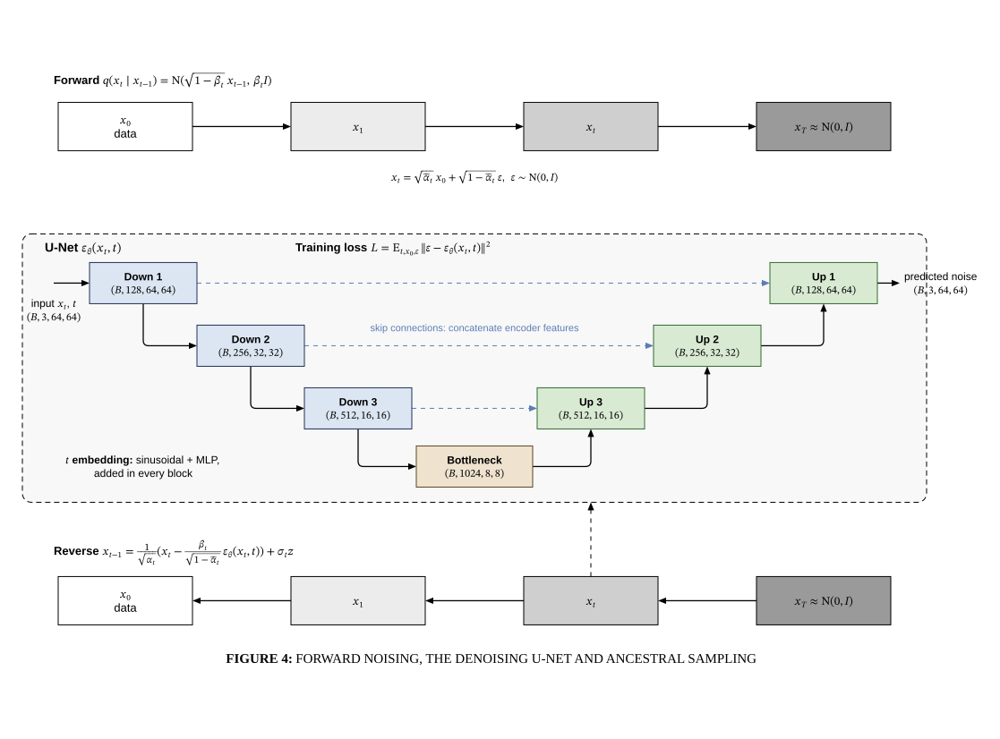

# Diffusion forward and reverse process

## Bill of Materials

| Symbol / ID | Label | Kind | Group | Technical Notes / Metadata |
| :--- | :--- | :--- | :--- | :--- |
| `shape_1` | **$x_0$ data** | box | - | - |
| `shape_2` | **$x_1$** | box | - | - |
| `shape_3` | **$x_t$** | box | - | - |
| `shape_4` | **$x_T \approx \mathrm{N}(0, I)$** | box | - | - |
| `shape_7` | **** | box | - | - |
| `shape_9` | ****Down 1** $(B, 128, 64, 64)$** | box | - | - |
| `shape_10` | ****Down 2** $(B, 256, 32, 32)$** | box | - | - |
| `shape_11` | ****Down 3** $(B, 512, 16, 16)$** | box | - | - |
| `shape_12` | ****Up 1** $(B, 128, 64, 64)$** | box | - | - |
| `shape_13` | ****Up 2** $(B, 256, 32, 32)$** | box | - | - |
| `shape_14` | ****Up 3** $(B, 512, 16, 16)$** | box | - | - |
| `shape_15` | ****Bottleneck** $(B, 1024, 8, 8)$** | box | - | - |
| `shape_23` | **$x_0$ data** | box | - | - |
| `shape_24` | **$x_1$** | box | - | - |
| `shape_25` | **$x_t$** | box | - | - |
| `shape_26` | **$x_T \approx \mathrm{N}(0, I)$** | box | - | - |

## Connections

| Source | Target | Protocol / Label | Style | Routing |
| :--- | :--- | :--- | :--- | :--- |
| **$x_0$ data** (`shape_1`) | **$x_1$** (`shape_2`) | - | solid | orthogonal |
| **$x_1$** (`shape_2`) | **$x_t$** (`shape_3`) | - | solid | orthogonal |
| **$x_t$** (`shape_3`) | **$x_T \approx \mathrm{N}(0, I)$** (`shape_4`) | - | solid | orthogonal |
| ****Down 1** $(B, 128, 64, 64)$** (`shape_9`) | ****Down 2** $(B, 256, 32, 32)$** (`shape_10`) | - | solid | orthogonal |
| ****Down 2** $(B, 256, 32, 32)$** (`shape_10`) | ****Down 3** $(B, 512, 16, 16)$** (`shape_11`) | - | solid | orthogonal |
| ****Down 3** $(B, 512, 16, 16)$** (`shape_11`) | ****Bottleneck** $(B, 1024, 8, 8)$** (`shape_15`) | - | solid | orthogonal |
| ****Bottleneck** $(B, 1024, 8, 8)$** (`shape_15`) | ****Up 3** $(B, 512, 16, 16)$** (`shape_14`) | - | solid | orthogonal |
| ****Up 3** $(B, 512, 16, 16)$** (`shape_14`) | ****Up 2** $(B, 256, 32, 32)$** (`shape_13`) | - | solid | orthogonal |
| ****Up 2** $(B, 256, 32, 32)$** (`shape_13`) | ****Up 1** $(B, 128, 64, 64)$** (`shape_12`) | - | solid | orthogonal |
| ****Down 1** $(B, 128, 64, 64)$** (`shape_9`) | ****Up 1** $(B, 128, 64, 64)$** (`shape_12`) | - | dashed | orthogonal |
| ****Down 2** $(B, 256, 32, 32)$** (`shape_10`) | ****Up 2** $(B, 256, 32, 32)$** (`shape_13`) | - | dashed | orthogonal |
| ****Down 3** $(B, 512, 16, 16)$** (`shape_11`) | ****Up 3** $(B, 512, 16, 16)$** (`shape_14`) | - | dashed | orthogonal |
| **point_18** (`point_18`) | ****Down 1** $(B, 128, 64, 64)$** (`shape_9`) | - | solid | direct |
| ****Up 1** $(B, 128, 64, 64)$** (`shape_12`) | **point_21** (`point_21`) | - | solid | direct |
| **$x_T \approx \mathrm{N}(0, I)$** (`shape_26`) | **$x_t$** (`shape_25`) | - | solid | orthogonal |
| **$x_t$** (`shape_25`) | **$x_1$** (`shape_24`) | - | solid | orthogonal |
| **$x_1$** (`shape_24`) | **$x_0$ data** (`shape_23`) | - | solid | orthogonal |
| **$x_t$** (`shape_25`) | **point_28** (`point_28`) | - | dashed | direct |
