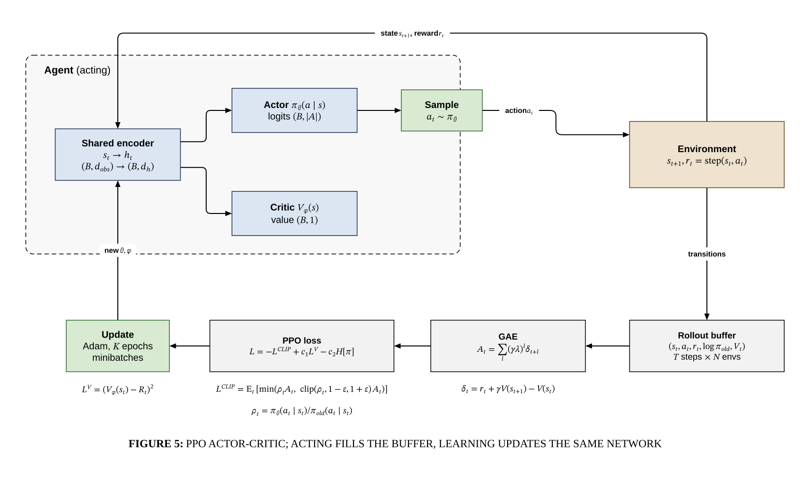

# PPO actor-critic agent-environment loop

## Bill of Materials

| Symbol / ID | Label | Kind | Group | Technical Notes / Metadata |
| :--- | :--- | :--- | :--- | :--- |
| `shape_1` | **** | box | - | - |
| `shape_3` | ****Shared encoder** $s_t \to h_t$ $(B, d_{obs}) \to (B, d_h)$** | box | - | - |
| `shape_4` | ****Actor** $\pi_\theta(a \mid s)$ logits $(B, \|A\|)$** | box | - | - |
| `shape_5` | ****Critic** $V_\phi(s)$ value $(B, 1)$** | box | - | - |
| `shape_6` | ****Sample** $a_t \sim \pi_\theta$** | box | - | - |
| `shape_7` | ****Environment** $s_{t+1}, r_t = \mathrm{step}(s_t, a_t)$** | box | - | - |
| `shape_8` | ****Rollout buffer** $(s_t, a_t, r_t, \log\pi_{old}, V_t)$ $T$ steps $\times$ $N$ envs** | box | - | - |
| `shape_9` | ****GAE** $A_t = \sum_l (\gamma\lambda)^l \delta_{t+l}$** | box | - | - |
| `shape_10` | ****PPO loss** $L = -L^{CLIP} + c_1 L^{V} - c_2 H[\pi]$** | box | - | - |
| `shape_11` | ****Update** Adam, $K$ epochs minibatches** | box | - | - |

## Connections

| Source | Target | Protocol / Label | Style | Routing |
| :--- | :--- | :--- | :--- | :--- |
| ****Shared encoder** $s_t \to h_t$ $(B, d_{obs}) \to (B, d_h)$** (`shape_3`) | ****Actor** $\pi_\theta(a \mid s)$ logits $(B, \|A\|)$** (`shape_4`) | - | solid | orthogonal |
| ****Shared encoder** $s_t \to h_t$ $(B, d_{obs}) \to (B, d_h)$** (`shape_3`) | ****Critic** $V_\phi(s)$ value $(B, 1)$** (`shape_5`) | - | solid | orthogonal |
| ****Actor** $\pi_\theta(a \mid s)$ logits $(B, \|A\|)$** (`shape_4`) | ****Sample** $a_t \sim \pi_\theta$** (`shape_6`) | - | solid | orthogonal |
| ****Sample** $a_t \sim \pi_\theta$** (`shape_6`) | ****Environment** $s_{t+1}, r_t = \mathrm{step}(s_t, a_t)$** (`shape_7`) | action $a_t$ | solid | orthogonal |
| ****Environment** $s_{t+1}, r_t = \mathrm{step}(s_t, a_t)$** (`shape_7`) | ****Shared encoder** $s_t \to h_t$ $(B, d_{obs}) \to (B, d_h)$** (`shape_3`) | state $s_{t+1}$, reward $r_t$ | solid | orthogonal |
| ****Environment** $s_{t+1}, r_t = \mathrm{step}(s_t, a_t)$** (`shape_7`) | ****Rollout buffer** $(s_t, a_t, r_t, \log\pi_{old}, V_t)$ $T$ steps $\times$ $N$ envs** (`shape_8`) | transitions | solid | orthogonal |
| ****Rollout buffer** $(s_t, a_t, r_t, \log\pi_{old}, V_t)$ $T$ steps $\times$ $N$ envs** (`shape_8`) | ****GAE** $A_t = \sum_l (\gamma\lambda)^l \delta_{t+l}$** (`shape_9`) | - | solid | orthogonal |
| ****GAE** $A_t = \sum_l (\gamma\lambda)^l \delta_{t+l}$** (`shape_9`) | ****PPO loss** $L = -L^{CLIP} + c_1 L^{V} - c_2 H[\pi]$** (`shape_10`) | - | solid | orthogonal |
| ****PPO loss** $L = -L^{CLIP} + c_1 L^{V} - c_2 H[\pi]$** (`shape_10`) | ****Update** Adam, $K$ epochs minibatches** (`shape_11`) | - | solid | orthogonal |
| ****Update** Adam, $K$ epochs minibatches** (`shape_11`) | ****Shared encoder** $s_t \to h_t$ $(B, d_{obs}) \to (B, d_h)$** (`shape_3`) | new $\theta, \phi$ | solid | orthogonal |
