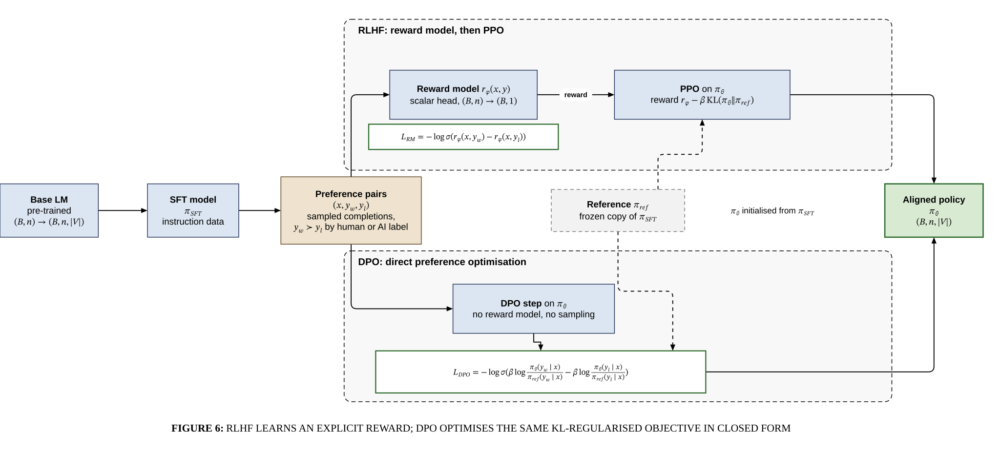

# RLHF and DPO preference-tuning pipelines

## Bill of Materials

| Symbol / ID | Label | Kind | Group | Technical Notes / Metadata |
| :--- | :--- | :--- | :--- | :--- |
| `shape_1` | **** | box | - | - |
| `shape_3` | **** | box | - | - |
| `shape_5` | ****Base LM** pre-trained $(B, n) \to (B, n, \|V\|)$** | box | - | - |
| `shape_6` | ****SFT model** $\pi_{SFT}$ instruction data** | box | - | - |
| `shape_7` | ****Preference pairs** $(x, y_w, y_l)$ sampled completions, $y_w \succ y_l$ by human or AI label** | box | - | - |
| `shape_8` | ****Reference** $\pi_{ref}$ frozen copy of $\pi_{SFT}$** | box | - | - |
| `shape_9` | ****Reward model** $r_\phi(x, y)$ scalar head, $(B, n) \to (B, 1)$** | box | - | - |
| `shape_10` | ****PPO** on $\pi_\theta$ reward $r_\phi - \beta\,\mathrm{KL}(\pi_\theta \\| \pi_{ref})$** | box | - | - |
| `shape_11` | **$L_{RM} = -\log \sigma(r_\phi(x, y_w) - r_\phi(x, y_l))$** | box | - | - |
| `shape_12` | ****DPO step** on $\pi_\theta$ no reward model, no sampling** | box | - | - |
| `shape_13` | **$L_{DPO} = -\log \sigma\left(\beta \log \frac{\pi_\theta(y_w \mid x)}{\pi_{ref}(y_w \mid x)} - \beta \log \frac{\pi_\theta(y_l \mid x)}{\pi_{ref}(y_l \mid x)}\right)$** | box | - | - |
| `shape_14` | ****Aligned policy** $\pi_\theta$ $(B, n, \|V\|)$** | box | - | - |

## Connections

| Source | Target | Protocol / Label | Style | Routing |
| :--- | :--- | :--- | :--- | :--- |
| ****Base LM** pre-trained $(B, n) \to (B, n, \|V\|)$** (`shape_5`) | ****SFT model** $\pi_{SFT}$ instruction data** (`shape_6`) | - | solid | orthogonal |
| ****SFT model** $\pi_{SFT}$ instruction data** (`shape_6`) | ****Preference pairs** $(x, y_w, y_l)$ sampled completions, $y_w \succ y_l$ by human or AI label** (`shape_7`) | - | solid | orthogonal |
| ****Preference pairs** $(x, y_w, y_l)$ sampled completions, $y_w \succ y_l$ by human or AI label** (`shape_7`) | ****Reward model** $r_\phi(x, y)$ scalar head, $(B, n) \to (B, 1)$** (`shape_9`) | - | solid | orthogonal |
| ****Preference pairs** $(x, y_w, y_l)$ sampled completions, $y_w \succ y_l$ by human or AI label** (`shape_7`) | ****DPO step** on $\pi_\theta$ no reward model, no sampling** (`shape_12`) | - | solid | orthogonal |
| ****Reward model** $r_\phi(x, y)$ scalar head, $(B, n) \to (B, 1)$** (`shape_9`) | ****PPO** on $\pi_\theta$ reward $r_\phi - \beta\,\mathrm{KL}(\pi_\theta \\| \pi_{ref})$** (`shape_10`) | reward | solid | orthogonal |
| ****Reference** $\pi_{ref}$ frozen copy of $\pi_{SFT}$** (`shape_8`) | ****PPO** on $\pi_\theta$ reward $r_\phi - \beta\,\mathrm{KL}(\pi_\theta \\| \pi_{ref})$** (`shape_10`) | - | dashed | orthogonal |
| ****Reference** $\pi_{ref}$ frozen copy of $\pi_{SFT}$** (`shape_8`) | **$L_{DPO} = -\log \sigma\left(\beta \log \frac{\pi_\theta(y_w \mid x)}{\pi_{ref}(y_w \mid x)} - \beta \log \frac{\pi_\theta(y_l \mid x)}{\pi_{ref}(y_l \mid x)}\right)$** (`shape_13`) | - | dashed | orthogonal |
| ****DPO step** on $\pi_\theta$ no reward model, no sampling** (`shape_12`) | **$L_{DPO} = -\log \sigma\left(\beta \log \frac{\pi_\theta(y_w \mid x)}{\pi_{ref}(y_w \mid x)} - \beta \log \frac{\pi_\theta(y_l \mid x)}{\pi_{ref}(y_l \mid x)}\right)$** (`shape_13`) | - | solid | orthogonal |
| ****PPO** on $\pi_\theta$ reward $r_\phi - \beta\,\mathrm{KL}(\pi_\theta \\| \pi_{ref})$** (`shape_10`) | ****Aligned policy** $\pi_\theta$ $(B, n, \|V\|)$** (`shape_14`) | - | solid | orthogonal |
| **$L_{DPO} = -\log \sigma\left(\beta \log \frac{\pi_\theta(y_w \mid x)}{\pi_{ref}(y_w \mid x)} - \beta \log \frac{\pi_\theta(y_l \mid x)}{\pi_{ref}(y_l \mid x)}\right)$** (`shape_13`) | ****Aligned policy** $\pi_\theta$ $(B, n, \|V\|)$** (`shape_14`) | - | solid | orthogonal |
