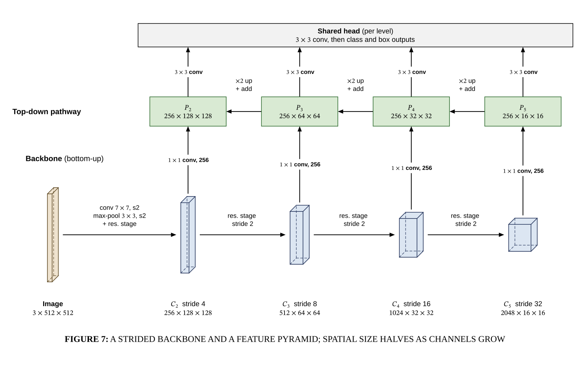

# CNN backbone with feature pyramid

## Bill of Materials

| Symbol / ID | Label | Kind | Group | Technical Notes / Metadata |
| :--- | :--- | :--- | :--- | :--- |
| `shape_23` | ****$P_2$** $256 \times 128 \times 128$** | box | - | - |
| `shape_24` | ****$P_3$** $256 \times 64 \times 64$** | box | - | - |
| `shape_25` | ****$P_4$** $256 \times 32 \times 32$** | box | - | - |
| `shape_26` | ****$P_5$** $256 \times 16 \times 16$** | box | - | - |
| `shape_34` | ****Shared head** (per level) $3 \times 3$ conv, then class and box outputs** | box | - | - |

## Connections

| Source | Target | Protocol / Label | Style | Routing |
| :--- | :--- | :--- | :--- | :--- |
| **point_4** (`point_4`) | **point_5** (`point_5`) | - | solid | direct |
| **point_9** (`point_9`) | **point_10** (`point_10`) | - | solid | direct |
| **point_14** (`point_14`) | **point_15** (`point_15`) | - | solid | direct |
| **point_19** (`point_19`) | **point_20** (`point_20`) | - | solid | direct |
| **point_27** (`point_27`) | ****$P_2$** $256 \times 128 \times 128$** (`shape_23`) | $1 \times 1$ conv, 256 | solid | direct |
| **point_28** (`point_28`) | ****$P_3$** $256 \times 64 \times 64$** (`shape_24`) | $1 \times 1$ conv, 256 | solid | direct |
| **point_29** (`point_29`) | ****$P_4$** $256 \times 32 \times 32$** (`shape_25`) | $1 \times 1$ conv, 256 | solid | direct |
| **point_30** (`point_30`) | ****$P_5$** $256 \times 16 \times 16$** (`shape_26`) | $1 \times 1$ conv, 256 | solid | direct |
| ****$P_5$** $256 \times 16 \times 16$** (`shape_26`) | ****$P_4$** $256 \times 32 \times 32$** (`shape_25`) | - | solid | orthogonal |
| ****$P_4$** $256 \times 32 \times 32$** (`shape_25`) | ****$P_3$** $256 \times 64 \times 64$** (`shape_24`) | - | solid | orthogonal |
| ****$P_3$** $256 \times 64 \times 64$** (`shape_24`) | ****$P_2$** $256 \times 128 \times 128$** (`shape_23`) | - | solid | orthogonal |
| ****$P_2$** $256 \times 128 \times 128$** (`shape_23`) | ****Shared head** (per level) $3 \times 3$ conv, then class and box outputs** (`shape_34`) | $3 \times 3$ conv | solid | orthogonal |
| ****$P_3$** $256 \times 64 \times 64$** (`shape_24`) | ****Shared head** (per level) $3 \times 3$ conv, then class and box outputs** (`shape_34`) | $3 \times 3$ conv | solid | orthogonal |
| ****$P_4$** $256 \times 32 \times 32$** (`shape_25`) | ****Shared head** (per level) $3 \times 3$ conv, then class and box outputs** (`shape_34`) | $3 \times 3$ conv | solid | orthogonal |
| ****$P_5$** $256 \times 16 \times 16$** (`shape_26`) | ****Shared head** (per level) $3 \times 3$ conv, then class and box outputs** (`shape_34`) | $3 \times 3$ conv | solid | orthogonal |
