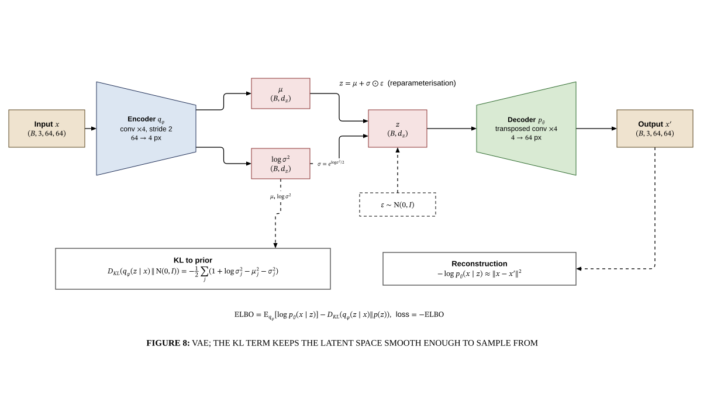

# Variational autoencoder

## Bill of Materials

| Symbol / ID | Label | Kind | Group | Technical Notes / Metadata |
| :--- | :--- | :--- | :--- | :--- |
| `shape_1` | ****Input** $x$ $(B, 3, 64, 64)$** | box | - | - |
| `shape_3` | **$\mu$ $(B, d_z)$** | box | - | - |
| `shape_4` | **$\log \sigma^2$ $(B, d_z)$** | box | - | - |
| `shape_5` | ****$z$** $(B, d_z)$** | box | - | - |
| `shape_6` | **$\epsilon \sim \mathrm{N}(0, I)$** | box | - | - |
| `shape_8` | ****Output** $x'$ $(B, 3, 64, 64)$** | box | - | - |
| `shape_10` | ****Reconstruction** $-\log p_\theta(x \mid z) \approx \\|x - x'\\|^2$** | box | - | - |
| `shape_11` | ****KL to prior** $D_{KL}(q_\phi(z \mid x) \,\\|\, \mathrm{N}(0, I)) = -\frac{1}{2} \sum_j (1 + \log\sigma_j^2 - \mu_j^2 - \sigma_j^2)$** | box | - | - |

## Connections

| Source | Target | Protocol / Label | Style | Routing |
| :--- | :--- | :--- | :--- | :--- |
| ****Input** $x$ $(B, 3, 64, 64)$** (`shape_1`) | ****Encoder** $q_\phi$ conv $\times 4$, stride 2 $64 \to 4$ px** (`polygon_2`) | - | solid | orthogonal |
| ****Encoder** $q_\phi$ conv $\times 4$, stride 2 $64 \to 4$ px** (`polygon_2`) | **$\mu$ $(B, d_z)$** (`shape_3`) | - | solid | orthogonal |
| ****Encoder** $q_\phi$ conv $\times 4$, stride 2 $64 \to 4$ px** (`polygon_2`) | **$\log \sigma^2$ $(B, d_z)$** (`shape_4`) | - | solid | orthogonal |
| **$\mu$ $(B, d_z)$** (`shape_3`) | ****$z$** $(B, d_z)$** (`shape_5`) | - | solid | orthogonal |
| **$\log \sigma^2$ $(B, d_z)$** (`shape_4`) | ****$z$** $(B, d_z)$** (`shape_5`) | $\sigma = e^{\log\sigma^2 / 2}$ | solid | orthogonal |
| **$\epsilon \sim \mathrm{N}(0, I)$** (`shape_6`) | ****$z$** $(B, d_z)$** (`shape_5`) | - | dashed | orthogonal |
| ****$z$** $(B, d_z)$** (`shape_5`) | ****Decoder** $p_\theta$ transposed conv $\times 4$ $4 \to 64$ px** (`polygon_7`) | - | solid | orthogonal |
| ****Decoder** $p_\theta$ transposed conv $\times 4$ $4 \to 64$ px** (`polygon_7`) | ****Output** $x'$ $(B, 3, 64, 64)$** (`shape_8`) | - | solid | orthogonal |
| ****Output** $x'$ $(B, 3, 64, 64)$** (`shape_8`) | ****Reconstruction** $-\log p_\theta(x \mid z) \approx \\|x - x'\\|^2$** (`shape_10`) | - | dashed | orthogonal |
| **$\log \sigma^2$ $(B, d_z)$** (`shape_4`) | ****KL to prior** $D_{KL}(q_\phi(z \mid x) \,\\|\, \mathrm{N}(0, I)) = -\frac{1}{2} \sum_j (1 + \log\sigma_j^2 - \mu_j^2 - \sigma_j^2)$** (`shape_11`) | $\mu$, $\log\sigma^2$ | dashed | orthogonal |
