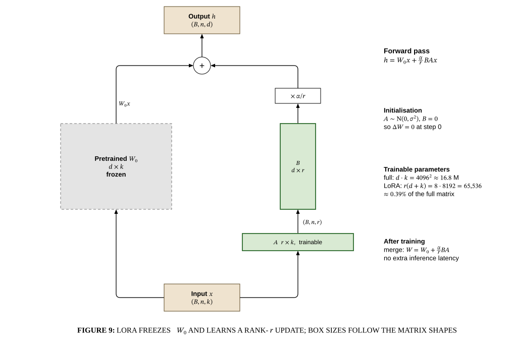

# LoRA low-rank weight update

## Bill of Materials

| Symbol / ID | Label | Kind | Group | Technical Notes / Metadata |
| :--- | :--- | :--- | :--- | :--- |
| `shape_1` | ****Output** $h$ $(B, n, d)$** | box | - | - |
| `shape_2` | **+** | box | - | - |
| `shape_3` | ****Pretrained** $W_0$ $d \times k$ **frozen**** | box | - | - |
| `shape_4` | **$\times\, \alpha / r$** | box | - | - |
| `shape_5` | **$B$ $d \times r$** | box | - | - |
| `shape_6` | ****$A$**  $r \times k$,  trainable** | box | - | - |
| `shape_7` | ****Input** $x$ $(B, n, k)$** | box | - | - |

## Connections

| Source | Target | Protocol / Label | Style | Routing |
| :--- | :--- | :--- | :--- | :--- |
| ****Input** $x$ $(B, n, k)$** (`shape_7`) | ****Pretrained** $W_0$ $d \times k$ **frozen**** (`shape_3`) | - | solid | orthogonal |
| ****Input** $x$ $(B, n, k)$** (`shape_7`) | ****$A$**  $r \times k$,  trainable** (`shape_6`) | - | solid | orthogonal |
| ****$A$**  $r \times k$,  trainable** (`shape_6`) | **$B$ $d \times r$** (`shape_5`) | - | solid | orthogonal |
| **$B$ $d \times r$** (`shape_5`) | **$\times\, \alpha / r$** (`shape_4`) | - | solid | orthogonal |
| ****Pretrained** $W_0$ $d \times k$ **frozen**** (`shape_3`) | **+** (`shape_2`) | - | solid | orthogonal |
| **$\times\, \alpha / r$** (`shape_4`) | **+** (`shape_2`) | - | solid | orthogonal |
| **+** (`shape_2`) | ****Output** $h$ $(B, n, d)$** (`shape_1`) | - | solid | orthogonal |
