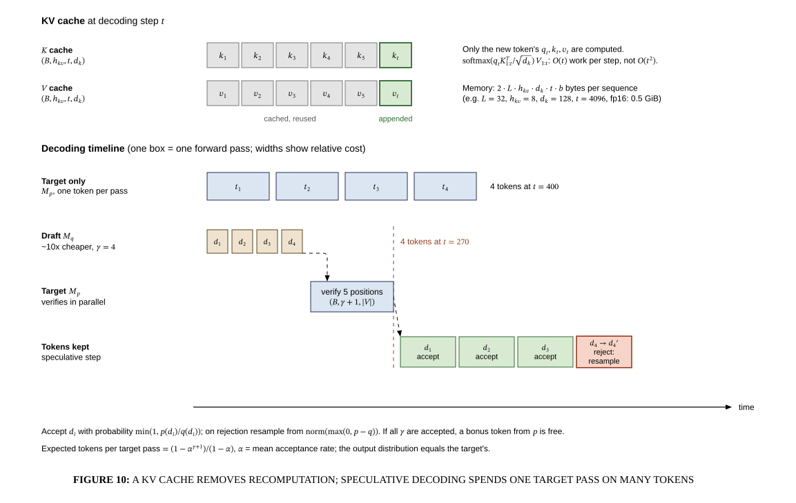

# KV cache and speculative decoding

## Bill of Materials

| Symbol / ID | Label | Kind | Group | Technical Notes / Metadata |
| :--- | :--- | :--- | :--- | :--- |
| `shape_3` | **$k_1$** | box | - | - |
| `shape_4` | **$k_2$** | box | - | - |
| `shape_5` | **$k_3$** | box | - | - |
| `shape_6` | **$k_4$** | box | - | - |
| `shape_7` | **$k_5$** | box | - | - |
| `shape_8` | **$k_t$** | box | - | - |
| `shape_10` | **$v_1$** | box | - | - |
| `shape_11` | **$v_2$** | box | - | - |
| `shape_12` | **$v_3$** | box | - | - |
| `shape_13` | **$v_4$** | box | - | - |
| `shape_14` | **$v_5$** | box | - | - |
| `shape_15` | **$v_t$** | box | - | - |
| `shape_25` | **$t_1$** | box | - | - |
| `shape_26` | **$t_2$** | box | - | - |
| `shape_27` | **$t_3$** | box | - | - |
| `shape_28` | **$t_4$** | box | - | - |
| `shape_30` | **$d_1$** | box | - | - |
| `shape_31` | **$d_2$** | box | - | - |
| `shape_32` | **$d_3$** | box | - | - |
| `shape_33` | **$d_4$** | box | - | - |
| `shape_34` | **verify 5 positions $(B, \gamma + 1, \|V\|)$** | box | - | - |
| `shape_35` | **$d_1$ accept** | box | - | - |
| `shape_36` | **$d_2$ accept** | box | - | - |
| `shape_37` | **$d_3$ accept** | box | - | - |
| `shape_38` | **$d_4 \to d_4'$ reject: resample** | box | - | - |

## Connections

| Source | Target | Protocol / Label | Style | Routing |
| :--- | :--- | :--- | :--- | :--- |
| **verify 5 positions $(B, \gamma + 1, \|V\|)$** (`shape_34`) | **point_39** (`point_39`) | - | dashed | direct |
| **point_40** (`point_40`) | **verify 5 positions $(B, \gamma + 1, \|V\|)$** (`shape_34`) | - | dashed | orthogonal |
| **point_41** (`point_41`) | **point_42** (`point_42`) | - | dashed | direct |
| **point_44** (`point_44`) | **point_45** (`point_45`) | - | solid | direct |
