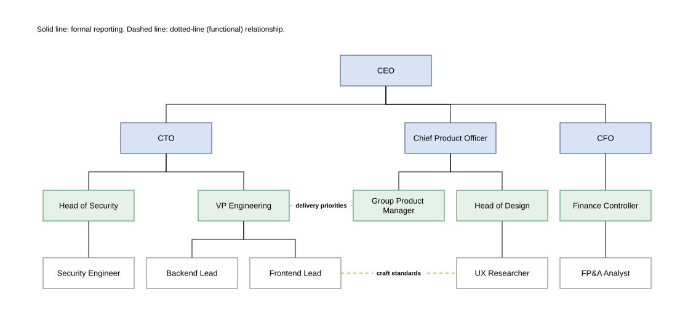

# Org chart with dotted-line reports

## Bill of Materials

| Symbol / ID | Label | Kind | Group | Technical Notes / Metadata |
| :--- | :--- | :--- | :--- | :--- |
| `shape_1` | **Security Engineer** | box | - | - |
| `shape_2` | **Head of Security** | box | - | - |
| `shape_3` | **Backend Lead** | box | - | - |
| `shape_4` | **Frontend Lead** | box | - | - |
| `shape_5` | **VP Engineering** | box | - | - |
| `shape_6` | **CTO** | box | - | - |
| `shape_7` | **Group Product Manager** | box | - | - |
| `shape_8` | **UX Researcher** | box | - | - |
| `shape_9` | **Head of Design** | box | - | - |
| `shape_10` | **Chief Product Officer** | box | - | - |
| `shape_11` | **FP&A Analyst** | box | - | - |
| `shape_12` | **Finance Controller** | box | - | - |
| `shape_13` | **CFO** | box | - | - |
| `shape_14` | **CEO** | box | - | - |

## Connections

| Source | Target | Protocol / Label | Style | Routing |
| :--- | :--- | :--- | :--- | :--- |
| **Head of Security** (`shape_2`) | **Security Engineer** (`shape_1`) | - | solid | orthogonal |
| **VP Engineering** (`shape_5`) | **Backend Lead** (`shape_3`) | - | solid | orthogonal |
| **VP Engineering** (`shape_5`) | **Frontend Lead** (`shape_4`) | - | solid | orthogonal |
| **CTO** (`shape_6`) | **Head of Security** (`shape_2`) | - | solid | orthogonal |
| **CTO** (`shape_6`) | **VP Engineering** (`shape_5`) | - | solid | orthogonal |
| **Head of Design** (`shape_9`) | **UX Researcher** (`shape_8`) | - | solid | orthogonal |
| **Chief Product Officer** (`shape_10`) | **Group Product Manager** (`shape_7`) | - | solid | orthogonal |
| **Chief Product Officer** (`shape_10`) | **Head of Design** (`shape_9`) | - | solid | orthogonal |
| **Finance Controller** (`shape_12`) | **FP&A Analyst** (`shape_11`) | - | solid | orthogonal |
| **CFO** (`shape_13`) | **Finance Controller** (`shape_12`) | - | solid | orthogonal |
| **CEO** (`shape_14`) | **CTO** (`shape_6`) | - | solid | orthogonal |
| **CEO** (`shape_14`) | **Chief Product Officer** (`shape_10`) | - | solid | orthogonal |
| **CEO** (`shape_14`) | **CFO** (`shape_13`) | - | solid | orthogonal |
| **VP Engineering** (`shape_5`) | **Group Product Manager** (`shape_7`) | delivery priorities | dashed | orthogonal |
| **Frontend Lead** (`shape_4`) | **UX Researcher** (`shape_8`) | craft standards | dashed | orthogonal |
