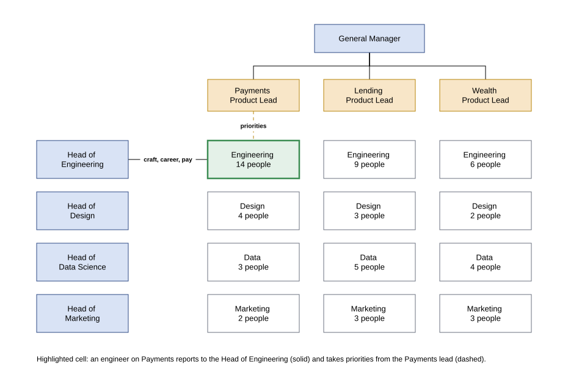

# Matrix organisation

## Bill of Materials

| Symbol / ID | Label | Kind | Group | Technical Notes / Metadata |
| :--- | :--- | :--- | :--- | :--- |
| `shape_1` | **General Manager** | box | - | - |
| `shape_2` | **Payments Product Lead** | box | - | - |
| `shape_3` | **Lending Product Lead** | box | - | - |
| `shape_4` | **Wealth Product Lead** | box | - | - |
| `shape_5` | **Head of Engineering** | box | - | - |
| `shape_6` | **Engineering 14 people** | box | - | - |
| `shape_7` | **Engineering 9 people** | box | - | - |
| `shape_8` | **Engineering 6 people** | box | - | - |
| `shape_9` | **Head of Design** | box | - | - |
| `shape_10` | **Design 4 people** | box | - | - |
| `shape_11` | **Design 3 people** | box | - | - |
| `shape_12` | **Design 2 people** | box | - | - |
| `shape_13` | **Head of Data Science** | box | - | - |
| `shape_14` | **Data 3 people** | box | - | - |
| `shape_15` | **Data 5 people** | box | - | - |
| `shape_16` | **Data 4 people** | box | - | - |
| `shape_17` | **Head of Marketing** | box | - | - |
| `shape_18` | **Marketing 2 people** | box | - | - |
| `shape_19` | **Marketing 3 people** | box | - | - |
| `shape_20` | **Marketing 3 people** | box | - | - |

## Connections

| Source | Target | Protocol / Label | Style | Routing |
| :--- | :--- | :--- | :--- | :--- |
| **General Manager** (`shape_1`) | **Payments Product Lead** (`shape_2`) | - | solid | orthogonal |
| **General Manager** (`shape_1`) | **Lending Product Lead** (`shape_3`) | - | solid | orthogonal |
| **General Manager** (`shape_1`) | **Wealth Product Lead** (`shape_4`) | - | solid | orthogonal |
| **Head of Engineering** (`shape_5`) | **Engineering 14 people** (`shape_6`) | craft, career, pay | solid | orthogonal |
| **Payments Product Lead** (`shape_2`) | **Engineering 14 people** (`shape_6`) | priorities | dashed | orthogonal |
