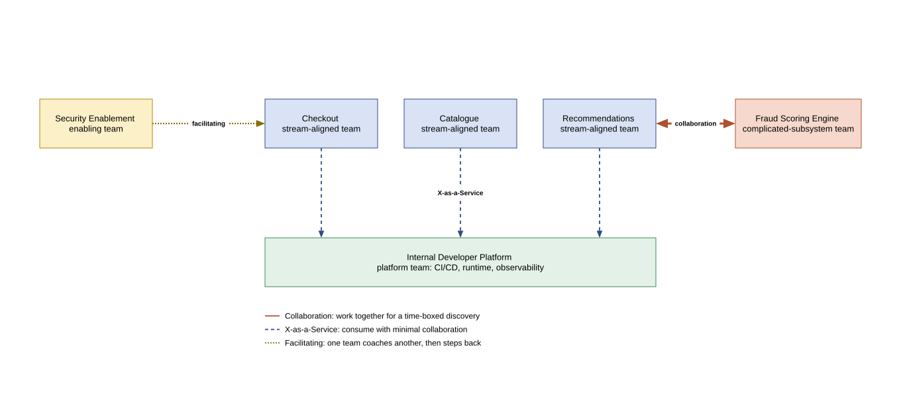

# Team Topologies

## Bill of Materials

| Symbol / ID | Label | Kind | Group | Technical Notes / Metadata |
| :--- | :--- | :--- | :--- | :--- |
| `shape_1` | **Security Enablement enabling team** | box | - | - |
| `shape_2` | **Checkout stream-aligned team** | box | - | - |
| `shape_3` | **Catalogue stream-aligned team** | box | - | - |
| `shape_4` | **Recommendations stream-aligned team** | box | - | - |
| `shape_5` | **Fraud Scoring Engine complicated-subsystem team** | box | - | - |
| `shape_6` | **Internal Developer Platform platform team: CI/CD, runtime, observability** | box | - | - |

## Connections

| Source | Target | Protocol / Label | Style | Routing |
| :--- | :--- | :--- | :--- | :--- |
| **Security Enablement enabling team** (`shape_1`) | **Checkout stream-aligned team** (`shape_2`) | facilitating | dotted | orthogonal |
| **Recommendations stream-aligned team** (`shape_4`) | **Fraud Scoring Engine complicated-subsystem team** (`shape_5`) | collaboration | solid | orthogonal |
| **Checkout stream-aligned team** (`shape_2`) | **Internal Developer Platform platform team: CI/CD, runtime, observability** (`shape_6`) | - | dashed | orthogonal |
| **Catalogue stream-aligned team** (`shape_3`) | **Internal Developer Platform platform team: CI/CD, runtime, observability** (`shape_6`) | X-as-a-Service | dashed | orthogonal |
| **Recommendations stream-aligned team** (`shape_4`) | **Internal Developer Platform platform team: CI/CD, runtime, observability** (`shape_6`) | - | dashed | orthogonal |
