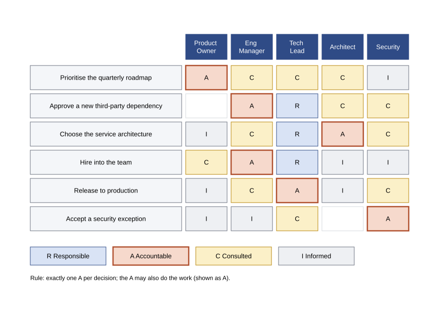

# Decision rights: RACI by role

## Bill of Materials

| Symbol / ID | Label | Kind | Group | Technical Notes / Metadata |
| :--- | :--- | :--- | :--- | :--- |
| `shape_1` | **Product Owner** | box | - | - |
| `shape_2` | **Eng Manager** | box | - | - |
| `shape_3` | **Tech Lead** | box | - | - |
| `shape_4` | **Architect** | box | - | - |
| `shape_5` | **Security** | box | - | - |
| `shape_6` | **Prioritise the quarterly roadmap** | box | - | - |
| `shape_7` | **A** | box | - | - |
| `shape_8` | **C** | box | - | - |
| `shape_9` | **C** | box | - | - |
| `shape_10` | **C** | box | - | - |
| `shape_11` | **I** | box | - | - |
| `shape_12` | **Approve a new third-party dependency** | box | - | - |
| `shape_13` | **** | box | - | - |
| `shape_14` | **A** | box | - | - |
| `shape_15` | **R** | box | - | - |
| `shape_16` | **C** | box | - | - |
| `shape_17` | **C** | box | - | - |
| `shape_18` | **Choose the service architecture** | box | - | - |
| `shape_19` | **I** | box | - | - |
| `shape_20` | **C** | box | - | - |
| `shape_21` | **R** | box | - | - |
| `shape_22` | **A** | box | - | - |
| `shape_23` | **C** | box | - | - |
| `shape_24` | **Hire into the team** | box | - | - |
| `shape_25` | **C** | box | - | - |
| `shape_26` | **A** | box | - | - |
| `shape_27` | **R** | box | - | - |
| `shape_28` | **I** | box | - | - |
| `shape_29` | **I** | box | - | - |
| `shape_30` | **Release to production** | box | - | - |
| `shape_31` | **I** | box | - | - |
| `shape_32` | **C** | box | - | - |
| `shape_33` | **A** | box | - | - |
| `shape_34` | **I** | box | - | - |
| `shape_35` | **C** | box | - | - |
| `shape_36` | **Accept a security exception** | box | - | - |
| `shape_37` | **I** | box | - | - |
| `shape_38` | **I** | box | - | - |
| `shape_39` | **C** | box | - | - |
| `shape_40` | **** | box | - | - |
| `shape_41` | **A** | box | - | - |
| `shape_42` | **R  Responsible** | box | - | - |
| `shape_43` | **A  Accountable** | box | - | - |
| `shape_44` | **C  Consulted** | box | - | - |
| `shape_45` | **I  Informed** | box | - | - |
