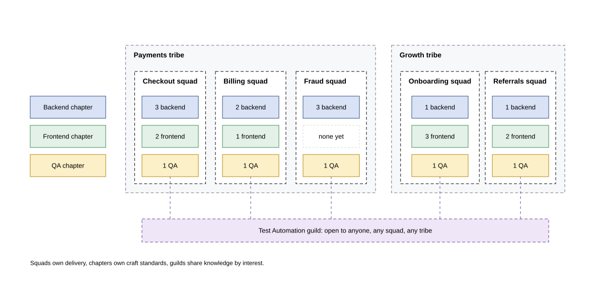

# Squads, tribes, chapters and guilds

## Bill of Materials

| Symbol / ID | Label | Kind | Group | Technical Notes / Metadata |
| :--- | :--- | :--- | :--- | :--- |
| `shape_3` | **3 backend** | box | Checkout squad | - |
| `shape_4` | **2 frontend** | box | Checkout squad | - |
| `shape_5` | **1 QA** | box | Checkout squad | - |
| `shape_7` | **2 backend** | box | Billing squad | - |
| `shape_8` | **1 frontend** | box | Billing squad | - |
| `shape_9` | **1 QA** | box | Billing squad | - |
| `shape_11` | **3 backend** | box | Fraud squad | - |
| `shape_12` | **none yet** | box | Fraud squad | - |
| `shape_13` | **1 QA** | box | Fraud squad | - |
| `shape_16` | **1 backend** | box | Onboarding squad | - |
| `shape_17` | **3 frontend** | box | Onboarding squad | - |
| `shape_18` | **1 QA** | box | Onboarding squad | - |
| `shape_20` | **1 backend** | box | Referrals squad | - |
| `shape_21` | **2 frontend** | box | Referrals squad | - |
| `shape_22` | **1 QA** | box | Referrals squad | - |
| `shape_23` | **Backend chapter** | box | - | - |
| `shape_24` | **Frontend chapter** | box | - | - |
| `shape_25` | **QA chapter** | box | - | - |
| `shape_26` | **Test Automation guild: open to anyone, any squad, any tribe** | box | - | - |

## Connections

| Source | Target | Protocol / Label | Style | Routing |
| :--- | :--- | :--- | :--- | :--- |
| **Test Automation guild: open to anyone, any squad, any tribe** (`shape_26`) | **1 QA** (`shape_5`) | - | dashed | orthogonal |
| **Test Automation guild: open to anyone, any squad, any tribe** (`shape_26`) | **1 QA** (`shape_9`) | - | dashed | orthogonal |
| **Test Automation guild: open to anyone, any squad, any tribe** (`shape_26`) | **1 QA** (`shape_13`) | - | dashed | orthogonal |
| **Test Automation guild: open to anyone, any squad, any tribe** (`shape_26`) | **1 QA** (`shape_18`) | - | dashed | orthogonal |
| **Test Automation guild: open to anyone, any squad, any tribe** (`shape_26`) | **1 QA** (`shape_22`) | - | dashed | orthogonal |
