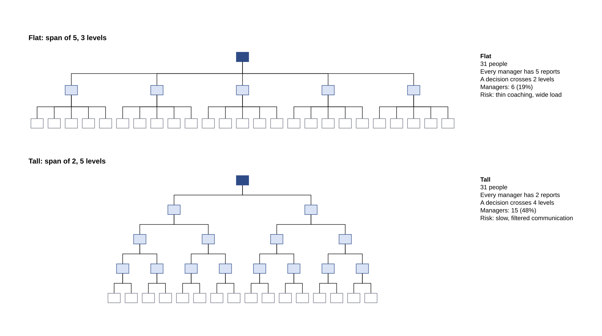

# Span of control: flat versus tall

## Bill of Materials

| Symbol / ID | Label | Kind | Group | Technical Notes / Metadata |
| :--- | :--- | :--- | :--- | :--- |
| `flat_0` | **** | box | - | - |
| `flat_1` | **** | box | - | - |
| `flat_2` | **** | box | - | - |
| `flat_3` | **** | box | - | - |
| `flat_4` | **** | box | - | - |
| `flat_5` | **** | box | - | - |
| `flat_6` | **** | box | - | - |
| `flat_7` | **** | box | - | - |
| `flat_8` | **** | box | - | - |
| `flat_9` | **** | box | - | - |
| `flat_10` | **** | box | - | - |
| `flat_11` | **** | box | - | - |
| `flat_12` | **** | box | - | - |
| `flat_13` | **** | box | - | - |
| `flat_14` | **** | box | - | - |
| `flat_15` | **** | box | - | - |
| `flat_16` | **** | box | - | - |
| `flat_17` | **** | box | - | - |
| `flat_18` | **** | box | - | - |
| `flat_19` | **** | box | - | - |
| `flat_20` | **** | box | - | - |
| `flat_21` | **** | box | - | - |
| `flat_22` | **** | box | - | - |
| `flat_23` | **** | box | - | - |
| `flat_24` | **** | box | - | - |
| `flat_25` | **** | box | - | - |
| `flat_26` | **** | box | - | - |
| `flat_27` | **** | box | - | - |
| `flat_28` | **** | box | - | - |
| `flat_29` | **** | box | - | - |
| `flat_30` | **** | box | - | - |
| `tall_0` | **** | box | - | - |
| `tall_1` | **** | box | - | - |
| `tall_2` | **** | box | - | - |
| `tall_3` | **** | box | - | - |
| `tall_4` | **** | box | - | - |
| `tall_5` | **** | box | - | - |
| `tall_6` | **** | box | - | - |
| `tall_7` | **** | box | - | - |
| `tall_8` | **** | box | - | - |
| `tall_9` | **** | box | - | - |
| `tall_10` | **** | box | - | - |
| `tall_11` | **** | box | - | - |
| `tall_12` | **** | box | - | - |
| `tall_13` | **** | box | - | - |
| `tall_14` | **** | box | - | - |
| `tall_15` | **** | box | - | - |
| `tall_16` | **** | box | - | - |
| `tall_17` | **** | box | - | - |
| `tall_18` | **** | box | - | - |
| `tall_19` | **** | box | - | - |
| `tall_20` | **** | box | - | - |
| `tall_21` | **** | box | - | - |
| `tall_22` | **** | box | - | - |
| `tall_23` | **** | box | - | - |
| `tall_24` | **** | box | - | - |
| `tall_25` | **** | box | - | - |
| `tall_26` | **** | box | - | - |
| `tall_27` | **** | box | - | - |
| `tall_28` | **** | box | - | - |
| `tall_29` | **** | box | - | - |
| `tall_30` | **** | box | - | - |

## Connections

| Source | Target | Protocol / Label | Style | Routing |
| :--- | :--- | :--- | :--- | :--- |
| **flat_30** (`flat_30`) | **flat_5** (`flat_5`) | - | solid | orthogonal |
| **flat_30** (`flat_30`) | **flat_11** (`flat_11`) | - | solid | orthogonal |
| **flat_30** (`flat_30`) | **flat_17** (`flat_17`) | - | solid | orthogonal |
| **flat_30** (`flat_30`) | **flat_23** (`flat_23`) | - | solid | orthogonal |
| **flat_30** (`flat_30`) | **flat_29** (`flat_29`) | - | solid | orthogonal |
| **flat_5** (`flat_5`) | **flat_0** (`flat_0`) | - | solid | orthogonal |
| **flat_5** (`flat_5`) | **flat_1** (`flat_1`) | - | solid | orthogonal |
| **flat_5** (`flat_5`) | **flat_2** (`flat_2`) | - | solid | orthogonal |
| **flat_5** (`flat_5`) | **flat_3** (`flat_3`) | - | solid | orthogonal |
| **flat_5** (`flat_5`) | **flat_4** (`flat_4`) | - | solid | orthogonal |
| **flat_11** (`flat_11`) | **flat_6** (`flat_6`) | - | solid | orthogonal |
| **flat_11** (`flat_11`) | **flat_7** (`flat_7`) | - | solid | orthogonal |
| **flat_11** (`flat_11`) | **flat_8** (`flat_8`) | - | solid | orthogonal |
| **flat_11** (`flat_11`) | **flat_9** (`flat_9`) | - | solid | orthogonal |
| **flat_11** (`flat_11`) | **flat_10** (`flat_10`) | - | solid | orthogonal |
| **flat_17** (`flat_17`) | **flat_12** (`flat_12`) | - | solid | orthogonal |
| **flat_17** (`flat_17`) | **flat_13** (`flat_13`) | - | solid | orthogonal |
| **flat_17** (`flat_17`) | **flat_14** (`flat_14`) | - | solid | orthogonal |
| **flat_17** (`flat_17`) | **flat_15** (`flat_15`) | - | solid | orthogonal |
| **flat_17** (`flat_17`) | **flat_16** (`flat_16`) | - | solid | orthogonal |
| **flat_23** (`flat_23`) | **flat_18** (`flat_18`) | - | solid | orthogonal |
| **flat_23** (`flat_23`) | **flat_19** (`flat_19`) | - | solid | orthogonal |
| **flat_23** (`flat_23`) | **flat_20** (`flat_20`) | - | solid | orthogonal |
| **flat_23** (`flat_23`) | **flat_21** (`flat_21`) | - | solid | orthogonal |
| **flat_23** (`flat_23`) | **flat_22** (`flat_22`) | - | solid | orthogonal |
| **flat_29** (`flat_29`) | **flat_24** (`flat_24`) | - | solid | orthogonal |
| **flat_29** (`flat_29`) | **flat_25** (`flat_25`) | - | solid | orthogonal |
| **flat_29** (`flat_29`) | **flat_26** (`flat_26`) | - | solid | orthogonal |
| **flat_29** (`flat_29`) | **flat_27** (`flat_27`) | - | solid | orthogonal |
| **flat_29** (`flat_29`) | **flat_28** (`flat_28`) | - | solid | orthogonal |
| **tall_30** (`tall_30`) | **tall_14** (`tall_14`) | - | solid | orthogonal |
| **tall_30** (`tall_30`) | **tall_29** (`tall_29`) | - | solid | orthogonal |
| **tall_14** (`tall_14`) | **tall_6** (`tall_6`) | - | solid | orthogonal |
| **tall_14** (`tall_14`) | **tall_13** (`tall_13`) | - | solid | orthogonal |
| **tall_29** (`tall_29`) | **tall_21** (`tall_21`) | - | solid | orthogonal |
| **tall_29** (`tall_29`) | **tall_28** (`tall_28`) | - | solid | orthogonal |
| **tall_6** (`tall_6`) | **tall_2** (`tall_2`) | - | solid | orthogonal |
| **tall_6** (`tall_6`) | **tall_5** (`tall_5`) | - | solid | orthogonal |
| **tall_13** (`tall_13`) | **tall_9** (`tall_9`) | - | solid | orthogonal |
| **tall_13** (`tall_13`) | **tall_12** (`tall_12`) | - | solid | orthogonal |
| **tall_21** (`tall_21`) | **tall_17** (`tall_17`) | - | solid | orthogonal |
| **tall_21** (`tall_21`) | **tall_20** (`tall_20`) | - | solid | orthogonal |
| **tall_28** (`tall_28`) | **tall_24** (`tall_24`) | - | solid | orthogonal |
| **tall_28** (`tall_28`) | **tall_27** (`tall_27`) | - | solid | orthogonal |
| **tall_2** (`tall_2`) | **tall_0** (`tall_0`) | - | solid | orthogonal |
| **tall_2** (`tall_2`) | **tall_1** (`tall_1`) | - | solid | orthogonal |
| **tall_5** (`tall_5`) | **tall_3** (`tall_3`) | - | solid | orthogonal |
| **tall_5** (`tall_5`) | **tall_4** (`tall_4`) | - | solid | orthogonal |
| **tall_9** (`tall_9`) | **tall_7** (`tall_7`) | - | solid | orthogonal |
| **tall_9** (`tall_9`) | **tall_8** (`tall_8`) | - | solid | orthogonal |
| **tall_12** (`tall_12`) | **tall_10** (`tall_10`) | - | solid | orthogonal |
| **tall_12** (`tall_12`) | **tall_11** (`tall_11`) | - | solid | orthogonal |
| **tall_17** (`tall_17`) | **tall_15** (`tall_15`) | - | solid | orthogonal |
| **tall_17** (`tall_17`) | **tall_16** (`tall_16`) | - | solid | orthogonal |
| **tall_20** (`tall_20`) | **tall_18** (`tall_18`) | - | solid | orthogonal |
| **tall_20** (`tall_20`) | **tall_19** (`tall_19`) | - | solid | orthogonal |
| **tall_24** (`tall_24`) | **tall_22** (`tall_22`) | - | solid | orthogonal |
| **tall_24** (`tall_24`) | **tall_23** (`tall_23`) | - | solid | orthogonal |
| **tall_27** (`tall_27`) | **tall_25** (`tall_25`) | - | solid | orthogonal |
| **tall_27** (`tall_27`) | **tall_26** (`tall_26`) | - | solid | orthogonal |
