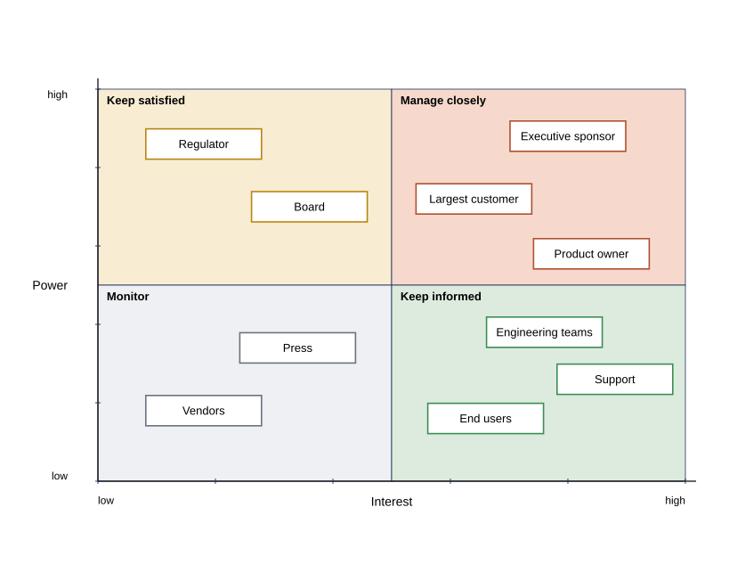

# Stakeholder power/interest grid

## Bill of Materials

| Symbol / ID | Label | Kind | Group | Technical Notes / Metadata |
| :--- | :--- | :--- | :--- | :--- |
| `shape_20` | **Regulator** | box | - | - |
| `shape_21` | **Board** | box | - | - |
| `shape_22` | **Executive sponsor** | box | - | - |
| `shape_23` | **Largest customer** | box | - | - |
| `shape_24` | **Product owner** | box | - | - |
| `shape_25` | **Vendors** | box | - | - |
| `shape_26` | **Press** | box | - | - |
| `shape_27` | **Engineering teams** | box | - | - |
| `shape_28` | **End users** | box | - | - |
| `shape_29` | **Support** | box | - | - |

## Connections

| Source | Target | Protocol / Label | Style | Routing |
| :--- | :--- | :--- | :--- | :--- |
| **point_9** (`point_9`) | **point_10** (`point_10`) | - | solid | direct |
| **point_11** (`point_11`) | **point_12** (`point_12`) | - | solid | direct |
