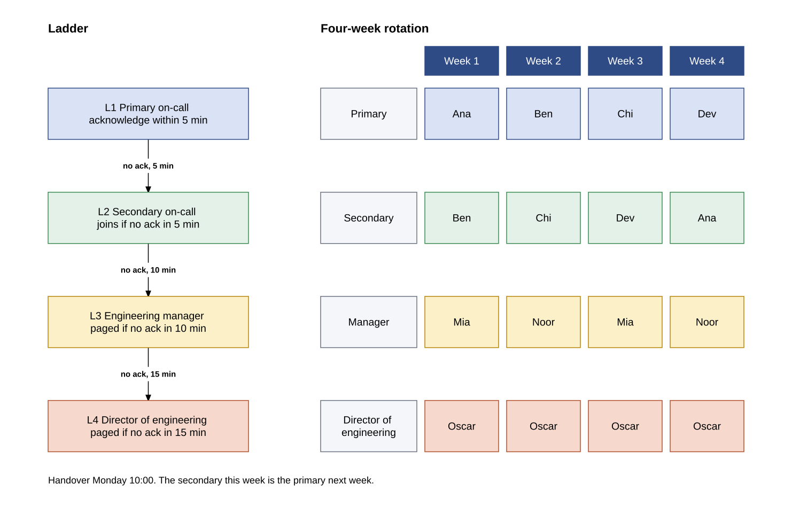

# On-call escalation ladder with rotation

## Bill of Materials

| Symbol / ID | Label | Kind | Group | Technical Notes / Metadata |
| :--- | :--- | :--- | :--- | :--- |
| `shape_1` | **L1 Primary on-call acknowledge within 5 min** | box | - | - |
| `shape_2` | **Primary** | box | - | - |
| `shape_3` | **Ana** | box | - | - |
| `shape_4` | **Ben** | box | - | - |
| `shape_5` | **Chi** | box | - | - |
| `shape_6` | **Dev** | box | - | - |
| `shape_7` | **L2 Secondary on-call joins if no ack in 5 min** | box | - | - |
| `shape_8` | **Secondary** | box | - | - |
| `shape_9` | **Ben** | box | - | - |
| `shape_10` | **Chi** | box | - | - |
| `shape_11` | **Dev** | box | - | - |
| `shape_12` | **Ana** | box | - | - |
| `shape_13` | **L3 Engineering manager paged if no ack in 10 min** | box | - | - |
| `shape_14` | **Manager** | box | - | - |
| `shape_15` | **Mia** | box | - | - |
| `shape_16` | **Noor** | box | - | - |
| `shape_17` | **Mia** | box | - | - |
| `shape_18` | **Noor** | box | - | - |
| `shape_19` | **L4 Director of engineering paged if no ack in 15 min** | box | - | - |
| `shape_20` | **Director of engineering** | box | - | - |
| `shape_21` | **Oscar** | box | - | - |
| `shape_22` | **Oscar** | box | - | - |
| `shape_23` | **Oscar** | box | - | - |
| `shape_24` | **Oscar** | box | - | - |
| `shape_25` | **Week 1** | box | - | - |
| `shape_26` | **Week 2** | box | - | - |
| `shape_27` | **Week 3** | box | - | - |
| `shape_28` | **Week 4** | box | - | - |

## Connections

| Source | Target | Protocol / Label | Style | Routing |
| :--- | :--- | :--- | :--- | :--- |
| **L1 Primary on-call acknowledge within 5 min** (`shape_1`) | **L2 Secondary on-call joins if no ack in 5 min** (`shape_7`) | no ack, 5 min | solid | orthogonal |
| **L2 Secondary on-call joins if no ack in 5 min** (`shape_7`) | **L3 Engineering manager paged if no ack in 10 min** (`shape_13`) | no ack, 10 min | solid | orthogonal |
| **L3 Engineering manager paged if no ack in 10 min** (`shape_13`) | **L4 Director of engineering paged if no ack in 15 min** (`shape_19`) | no ack, 15 min | solid | orthogonal |
