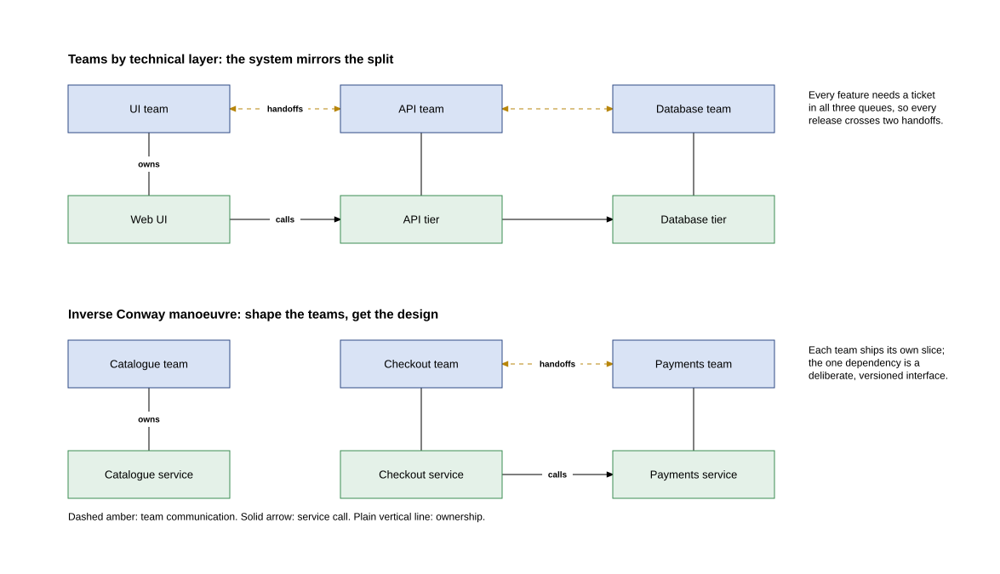

# Conway's law

## Bill of Materials

| Symbol / ID | Label | Kind | Group | Technical Notes / Metadata |
| :--- | :--- | :--- | :--- | :--- |
| `shape_2` | **UI team** | box | - | - |
| `shape_3` | **API team** | box | - | - |
| `shape_4` | **Database team** | box | - | - |
| `shape_5` | **Web UI** | box | - | - |
| `shape_6` | **API tier** | box | - | - |
| `shape_7` | **Database tier** | box | - | - |
| `shape_10` | **Catalogue team** | box | - | - |
| `shape_11` | **Checkout team** | box | - | - |
| `shape_12` | **Payments team** | box | - | - |
| `shape_13` | **Catalogue service** | box | - | - |
| `shape_14` | **Checkout service** | box | - | - |
| `shape_15` | **Payments service** | box | - | - |

## Connections

| Source | Target | Protocol / Label | Style | Routing |
| :--- | :--- | :--- | :--- | :--- |
| **UI team** (`shape_2`) | **Web UI** (`shape_5`) | owns | solid | orthogonal |
| **API team** (`shape_3`) | **API tier** (`shape_6`) | - | solid | orthogonal |
| **Database team** (`shape_4`) | **Database tier** (`shape_7`) | - | solid | orthogonal |
| **UI team** (`shape_2`) | **API team** (`shape_3`) | handoffs | dashed | orthogonal |
| **Web UI** (`shape_5`) | **API tier** (`shape_6`) | calls | solid | orthogonal |
| **API team** (`shape_3`) | **Database team** (`shape_4`) | - | dashed | orthogonal |
| **API tier** (`shape_6`) | **Database tier** (`shape_7`) | - | solid | orthogonal |
| **Catalogue team** (`shape_10`) | **Catalogue service** (`shape_13`) | owns | solid | orthogonal |
| **Checkout team** (`shape_11`) | **Checkout service** (`shape_14`) | - | solid | orthogonal |
| **Payments team** (`shape_12`) | **Payments service** (`shape_15`) | - | solid | orthogonal |
| **Checkout team** (`shape_11`) | **Payments team** (`shape_12`) | handoffs | dashed | orthogonal |
| **Checkout service** (`shape_14`) | **Payments service** (`shape_15`) | calls | solid | orthogonal |
