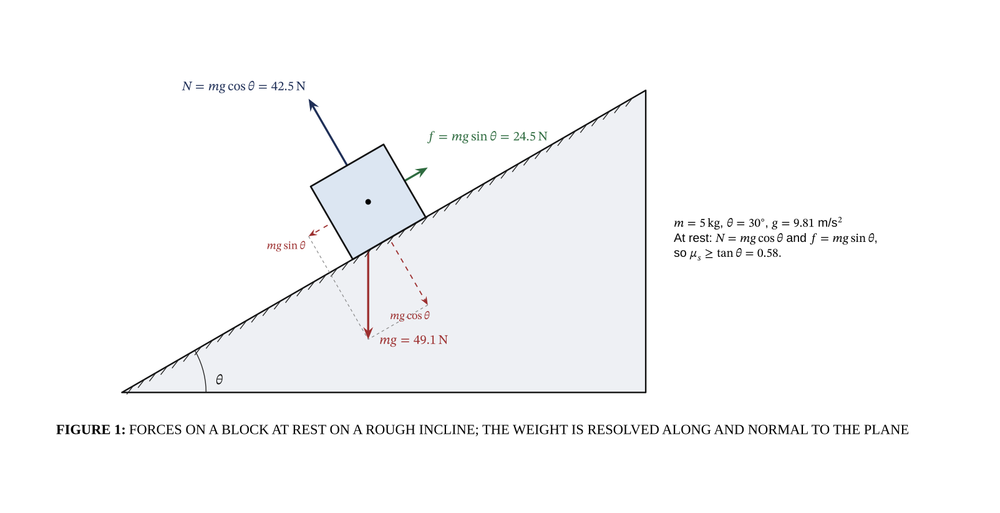

# Free-body diagram on an incline

## Bill of Materials

| Symbol / ID | Label | Kind | Group | Technical Notes / Metadata |
| :--- | :--- | :--- | :--- | :--- |

## Connections

| Source | Target | Protocol / Label | Style | Routing |
| :--- | :--- | :--- | :--- | :--- |
| **point_5** (`point_5`) | **point_6** (`point_6`) | - | solid | direct |
| **point_7** (`point_7`) | **point_8** (`point_8`) | - | solid | direct |
| **point_9** (`point_9`) | **point_10** (`point_10`) | - | solid | direct |
| **point_11** (`point_11`) | **point_12** (`point_12`) | - | dashed | direct |
| **point_13** (`point_13`) | **point_14** (`point_14`) | - | dashed | direct |
